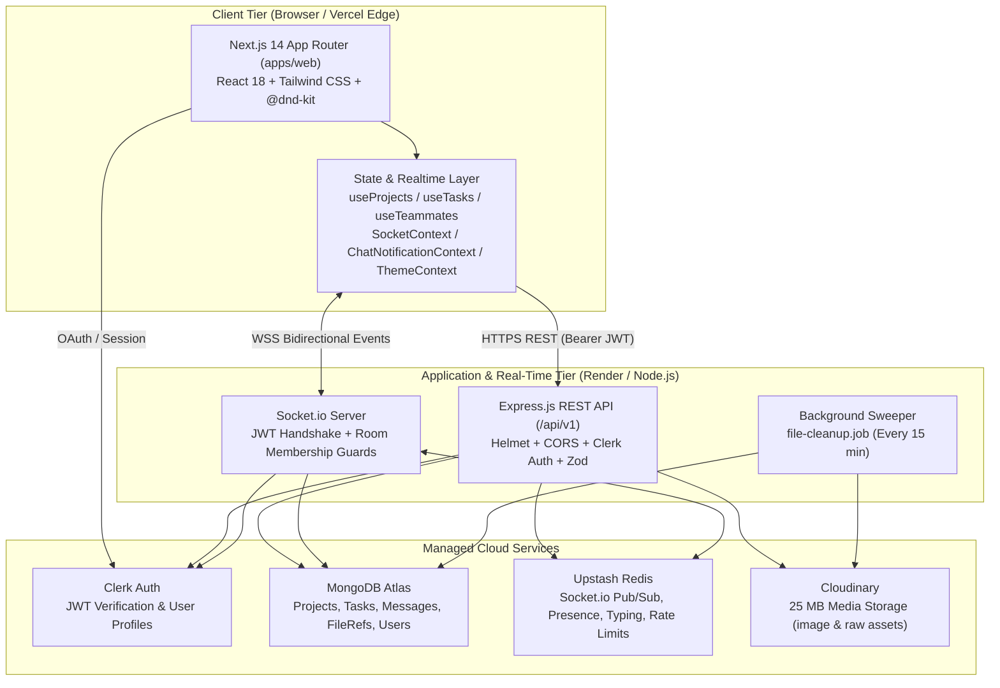
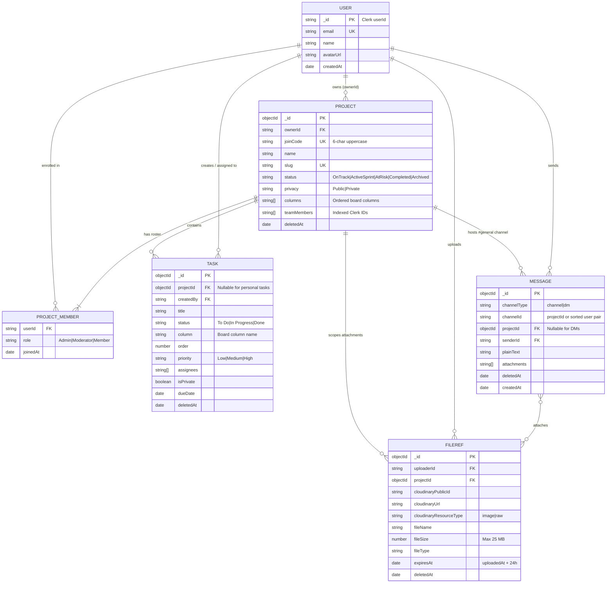
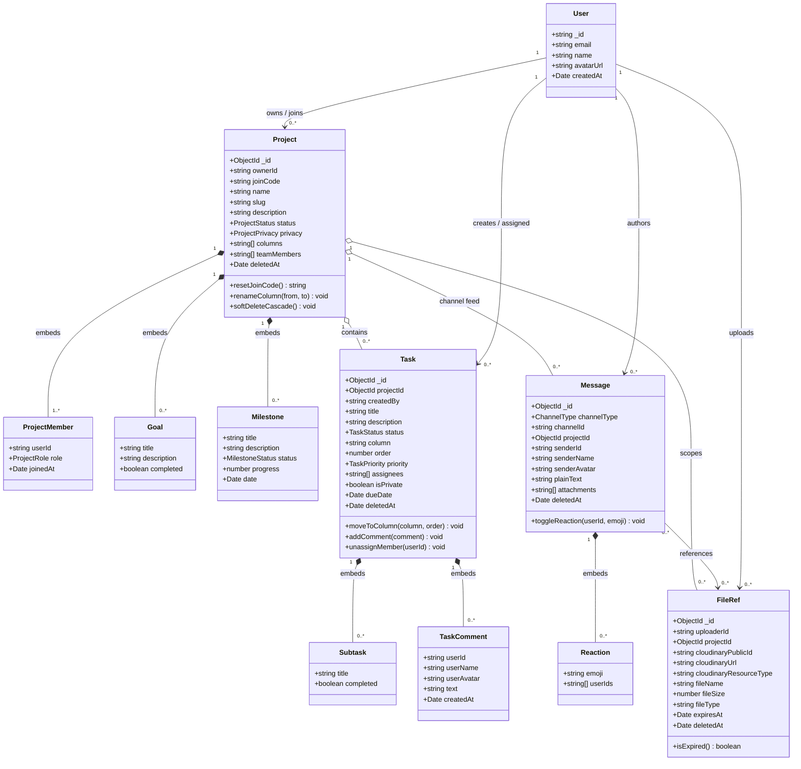
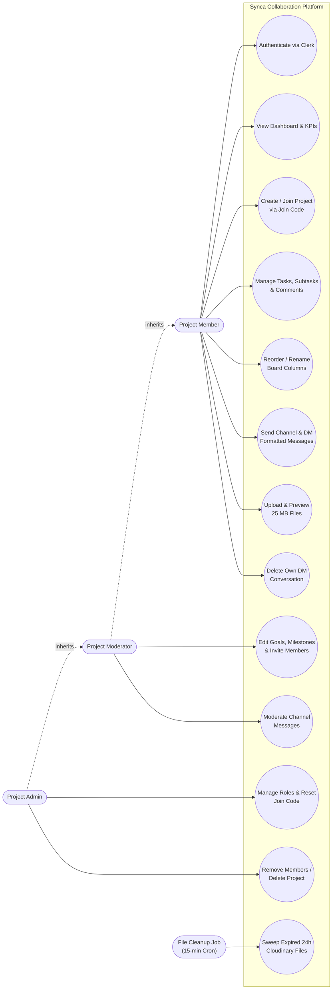
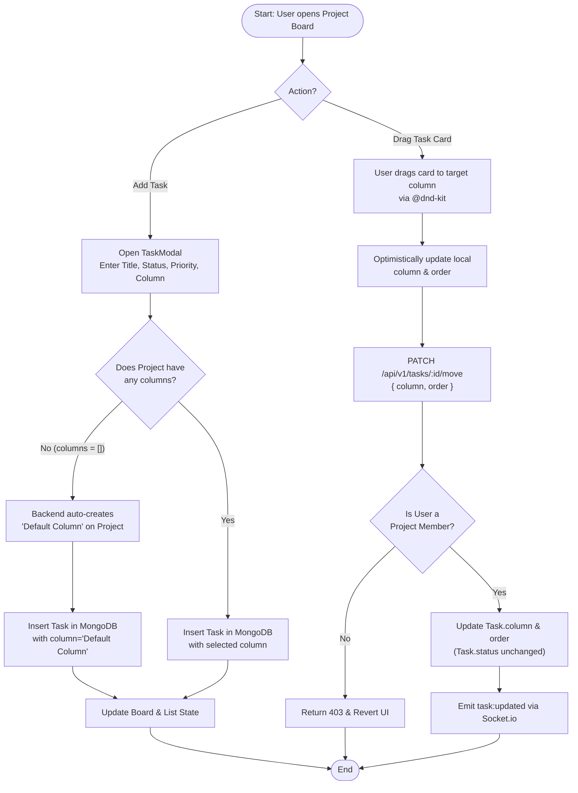
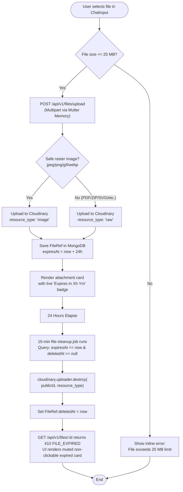
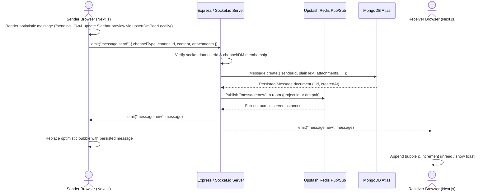
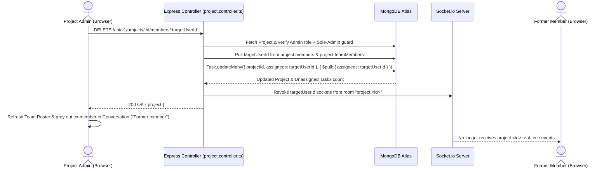
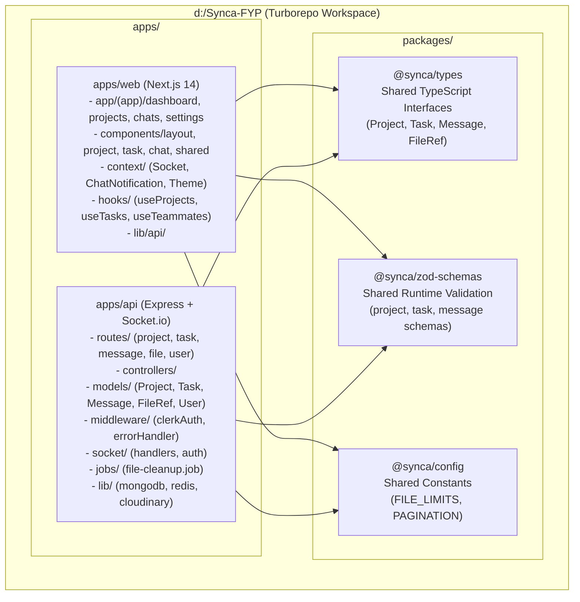
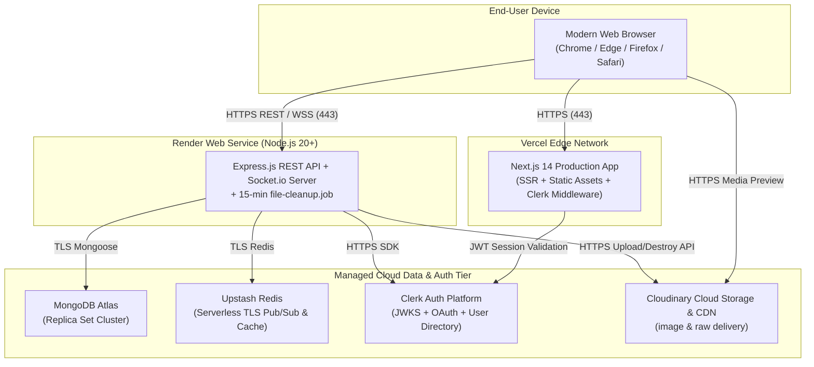

# Chapter 2: Design and Architecture

---

## 2.1 Architectural Style and Rationale

Synca employs a **Hybrid Client-Server, Event-Driven, Distributed Monorepo Architecture** tailored for low-latency collaborative software:

1. **Decoupled Client-Server Architecture**: The presentation tier (`apps/web`, Next.js 14 App Router) is strictly separated from the API & real-time application tier (`apps/api`, standalone Express.js + Socket.io server). Communication occurs exclusively over versioned HTTPS REST endpoints (`/api/v1/*`) and authenticated WebSocket Secure (WSS) channels.
2. **Event-Driven Real-Time Distributed Architecture**: To support concurrent messaging, typing indicators, live presence, and instant DM thread deletion across multiple horizontally scaled backend instances without sticky-session lock-in, Socket.io uses `@socket.io/redis-adapter` backed by **Upstash Redis Pub/Sub**. Any event published on Server Node A is instantaneously fanned out to connected clients on Server Node B.
3. **Layered Backend Pattern**: Within `apps/api`, HTTP transport, authorization, validation, domain logic, and persistence are separated cleanly across `Middleware` → `Routes` → `Controllers` → `Models` + scheduled `Jobs` (`file-cleanup.job.ts`).
4. **Shared-Contract Monorepo (Turborepo)**: Both applications consume three internal workspace packages — `@synca/types`, `@synca/zod-schemas`, and `@synca/config` — guaranteeing compile-time TypeScript parity and runtime Zod schema consistency between client and server.

---

## 2.2 High-Level System Architecture

*Figure 2.1: High-Level System Architecture Diagram*

---

## 2.3 Architecture Decision Records (ADRs)

| ADR | Decision | Architectural Rationale |
|---|---|---|
| **ADR-001** | **Turborepo Monorepo** (`apps/*`, `packages/*`) | Eliminates API contract drift by sharing TypeScript interfaces (`@synca/types`), Zod validators (`@synca/zod-schemas`), and limits (`@synca/config`). |
| **ADR-002** | **Standalone Express + Socket.io Server** | Serverless Next.js API routes cannot hold long-lived persistent WebSocket connections; a dedicated Node.js server provides full real-time and background-job control. |
| **ADR-003** | **MongoDB Atlas with Mongoose** | Flexible document nesting cleanly represents project goals, milestones, task subtasks, comments, and message reactions with compound indexes for cursor pagination. |
| **ADR-004** | **Upstash Redis Adapter** | Serverless Redis enables zero-ops horizontal Socket.io scaling, ephemeral typing/presence keys with short TTLs, and distributed rate limiting. |
| **ADR-005** | **Clerk Identity Provider** | Offloads password cryptography, OAuth, MFA, session rotation, and JWT verification to a hardened identity platform. |
| **ADR-006** | **User-Scoped SWR-Style React Hooks** | Custom hooks (`useProjects`, `useTasks`, `useTeammates`) maintain instant in-memory caches per user, eliminating full-page loading flashes on route navigation and supporting optimistic updates (`upsertDmPeerLocally`). |
| **ADR-007** | **Project-Centric Domain Model** | Eliminated redundant Workspace/Room layers so Projects serve as the single boundary for tasks, `#general` channels, roles, and join codes. |
| **ADR-008** | **Decoupled Board Columns & Task Status** | `Project.columns` and `Task.column` operate independently of `Task.status`, allowing teams to drag cards across custom workflow columns without corrupting completion metrics. |
| **ADR-009** | **Ephemeral 24-Hour File Transfers** | Universal file uploads (≤25 MB) routed safely to Cloudinary (`image` for raster images, `raw` for all other files) with automated 15-minute cleanup sweeping after `expiresAt`. |
| **ADR-010** | **Viewport-Locked Desktop Shell** | Locking the root layout to `h-screen overflow-hidden` with internal card scrolling prevents double scrollbars and preserves crisp rounded card framing across all screen sizes. |

---

## 2.4 Backend Layered Architecture & Middleware Pipeline

Every incoming REST request traverses a deterministic security and validation pipeline:

1. **Security & Transport Middleware**: `helmet()` sets CSP/HSTS headers; `cors()` enforces the whitelisted `CLIENT_URL`; `express.json()` parses request payloads.
2. **Authentication Middleware (`requireAuth`)**: Extracts and verifies the Clerk Bearer JWT, populating `req.auth.userId`.
3. **Validation & Rate Limiting**: Zod schemas from `@synca/zod-schemas` reject malformed bodies with structured `400 VALIDATION_ERROR` responses; sensitive routes apply per-user rate limits.
4. **Controller & RBAC Enforcement**: Controllers fetch the target `Project` / `Task` / `Message` / `FileRef`, execute project-scoped permission guards (`isProjectMember`, `isProjectAdmin`, `isProjectAdminOrMod`), perform atomic MongoDB updates, emit real-time Socket.io notifications where applicable, and return a standardized `{ success, data }` envelope.
5. **Centralized Error Handler**: Catches domain and Mongoose errors and maps them to safe, consistent HTTP status codes (`400`, `401`, `403`, `404`, `410`, `429`, `500`) without leaking stack traces in production.

---

## 2.5 Frontend Architecture & State Management

| State Category | Implementation | Responsibility |
|---|---|---|
| **Server Data & Optimistic Cache** | `useProjects`, `useTasks`, `useTeammates` | User-scoped caches, instant tab/route switches, optimistic DM sidebar updates, and column/task mutations |
| **Real-Time Transport** | `SocketContext` (`socket.io-client`) | Manages authenticated WSS lifecycle, room subscriptions (`project:*`, `dm:*`), and live online presence map |
| **Cross-App Notifications** | `ChatNotificationContext` | Tracks per-channel/per-DM unread counters and renders floating top-right toast alerts |
| **Appearance / Theme** | `ThemeContext` + Zero-FOUC inline script | Persists `'light' \| 'dark' \| 'system'` in `localStorage` and synchronizes `.dark` class on `<html>` |
| **URL / Navigation State** | Next.js App Router (`usePathname`, `useSearchParams`) | Deep-linking into DMs (`/chats?dm=...`), project tabs (`/projects/[id]?tab=conversation`), and invite links (`/projects/join?code=...`) |

---

## 2.6 Database Design & Entity-Relationship Diagram (ERD)

Synca uses MongoDB Atlas with five active collections (`users`, `projects`, `tasks`, `messages`, `filerefs`) plus a planned `notifications` collection for Phase 5. Soft deletion (`deletedAt: Date | null`) is enforced across all user-generated entities.

*Figure 2.2: MongoDB Entity-Relationship Diagram (ERD)*

---

## 2.7 UML Class Diagram

The UML Class Diagram below models Synca's core domain entities, embedded value objects (`Goal`, `Milestone`, `Subtask`, `TaskComment`, `Reaction`), and service/controller responsibilities.

*Figure 2.3: UML Class Diagram — Synca Core Domain Model*

---

## 2.8 UML Use Case Diagram

Synca defines three human actor roles scoped per project (`Admin`, `Moderator`, `Member`), plus an automated system actor (`File Cleanup Scheduler`) that enforces 24-hour file retention.

*Figure 2.4: UML Use Case Diagram — Actors and System Capabilities*

---

## 2.9 UML Activity Diagrams

### 2.9.1 Activity Diagram — Task Creation & Decoupled Kanban Column Movement

*Figure 2.5: UML Activity Diagram — Task Creation & Decoupled Kanban Movement*

### 2.9.2 Activity Diagram — Ephemeral 24-Hour File Upload & Expiration Lifecycle

*Figure 2.6: UML Activity Diagram — Ephemeral 24-Hour File Upload & Expiration Lifecycle*

---

## 2.10 UML Sequence Diagrams

### 2.10.1 Sequence Diagram — Real-Time Messaging via Socket.io & Upstash Redis

*Figure 2.7: UML Sequence Diagram — Real-Time Messaging via Socket.io & Redis*

### 2.10.2 Sequence Diagram — Member Removal & Automatic Task Unassignment

*Figure 2.8: UML Sequence Diagram — Member Removal & Automatic Task Unassignment*

---

## 2.11 UML Package Diagram

*Figure 2.9: UML Package Diagram — Turborepo Monorepo Structure*

---

## 2.12 UML Deployment Diagram

*Figure 2.10: UML Deployment Diagram — Production Cloud Topology*
