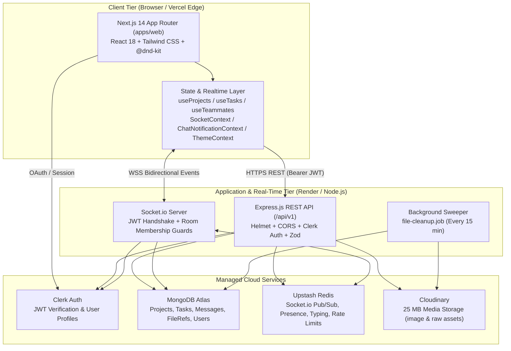
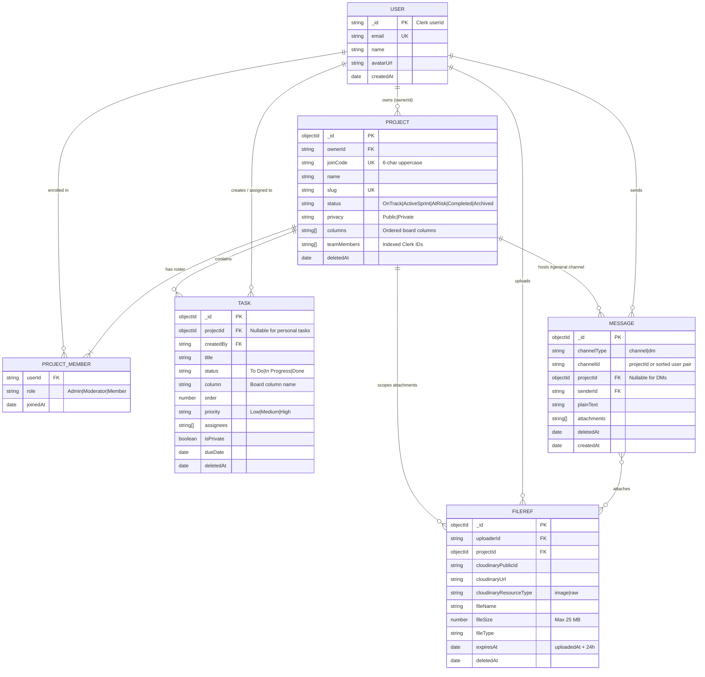
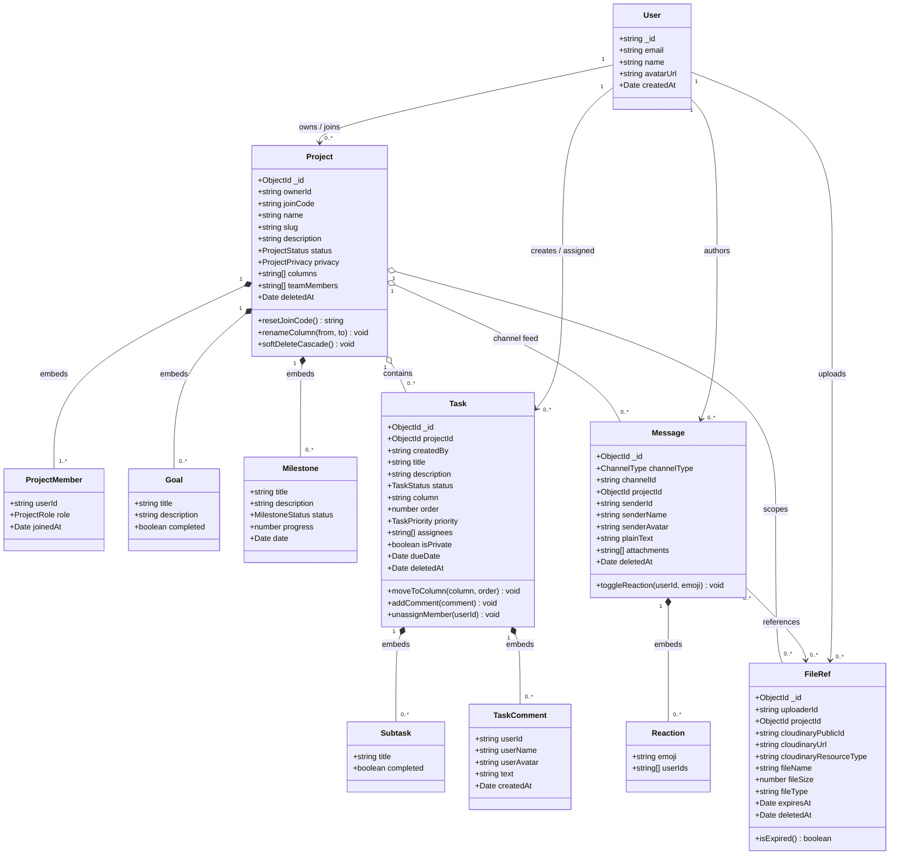
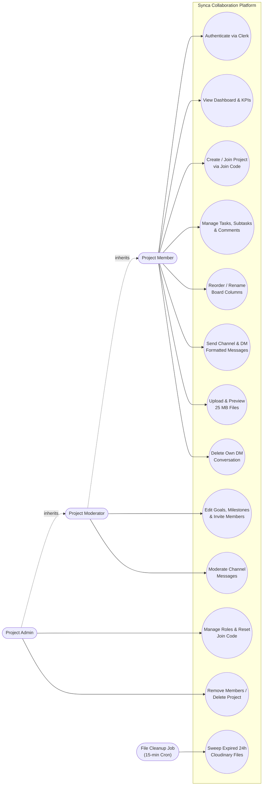
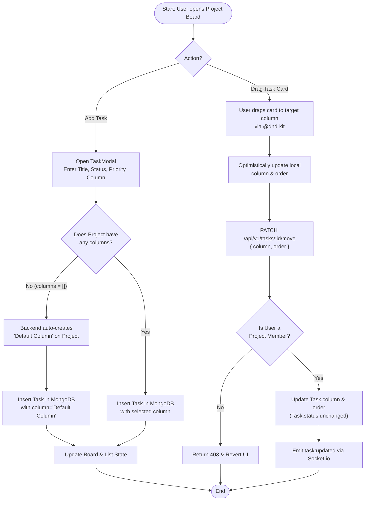
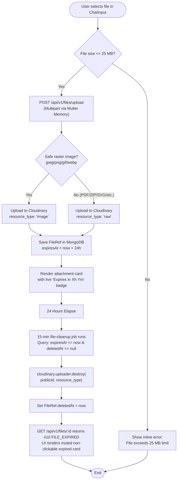
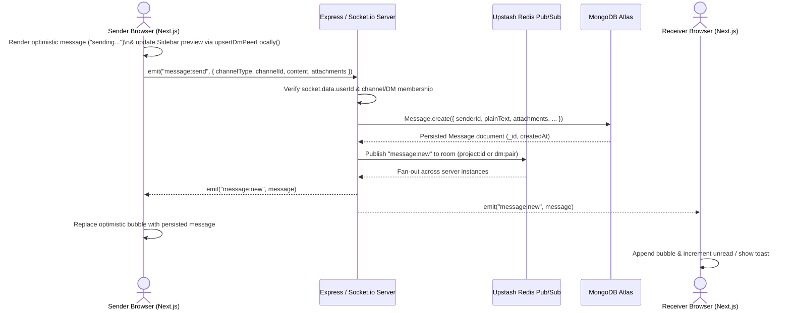
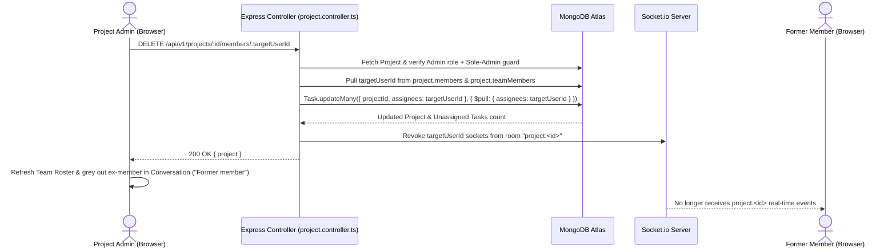
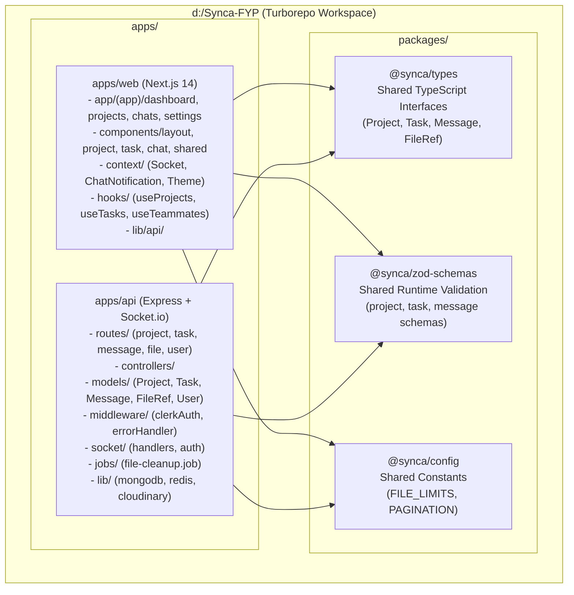
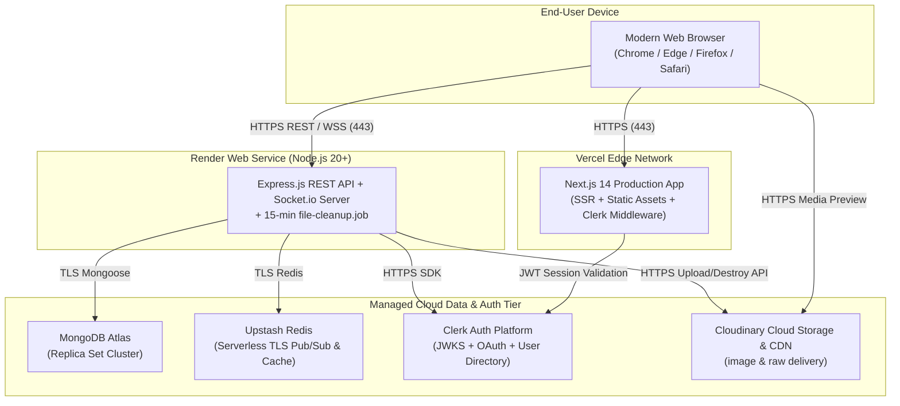

# SYNCA: A UNIFIED REAL-TIME TEAM COLLABORATION AND PROJECT MANAGEMENT PLATFORM

---

**A Final Year Project Report**  
Submitted in Partial Fulfillment of the Requirements for the Degree of  
**Bachelor of Science in Computer Science / Software Engineering**

---

| Field | Details |
|---|---|
| **Project Title** | Synca — Unified Real-Time Team Collaboration & Project Management Platform |
| **Student Name(s)** | *[Insert Student Name(s) & Roll Number(s)]* |
| **Supervisor** | *[Insert Supervisor Name & Designation]* |
| **Department** | *[Insert Department Name]* |
| **Institution** | *[Insert University / Institution Name]* |
| **Session / Year** | 2026 |

---

## Abstract

Modern software and knowledge-work teams routinely rely on a fragmented suite of disconnected tools: one platform for task tracking and Kanban boards (such as Trello, Jira, or Asana), a second platform for real-time team chat and direct messaging (such as Slack or Microsoft Teams), and a third service for ad-hoc file sharing and document exchange. This fragmentation introduces severe context-switching overhead, duplicated membership management, broken audit trails, and delayed feedback loops.

**Synca** is a unified, real-time, full-stack web collaboration platform engineered around a **Project-Centric Architecture** that brings project portfolio management, decoupled Kanban and List task tracking, milestone governance, real-time `#general` project channels, 1:1 Direct Messaging, and ephemeral 24-hour file sharing into a single viewport-locked workspace. Built as a TypeScript **Turborepo monorepo**, Synca pairs a **Next.js 14 (App Router)** frontend with a standalone **Express.js + Socket.io** backend, **MongoDB Atlas (Mongoose)** for persistent document storage, **Upstash Redis** for pub/sub WebSocket scaling, rate limiting, and ephemeral presence/typing state, **Clerk** for JWT authentication and identity management, and **Cloudinary** for multi-format file transfers with automated 24-hour lifecycle expiration.

This report documents the complete lifecycle of Synca across four core chapters: **Chapter 1 (Introduction)** details the problem space, objectives, functional and non-functional capabilities, REST/WebSocket APIs, security controls, and a screen-by-screen walkthrough of the user interface; **Chapter 2 (Design and Architecture)** presents the client-server, event-driven distributed architecture alongside formal UML Class, Use Case, Activity, Sequence, Package, Deployment, and Entity-Relationship diagrams; **Chapter 3 (Development Environment)** provides an exhaustive, beginner-friendly setup manual with verification and troubleshooting guides; and **Chapter 4 (Conclusion)** evaluates achievements, engineering lessons, current limitations, and the multi-phase future roadmap.

---

## Table of Contents

- **Front Matter**
  - Abstract
  - List of Figures
  - List of Tables
  - List of Abbreviations
- **Chapter 1: Introduction**
  - 1.1 Background and Motivation
  - 1.2 Problem Statement
  - 1.3 Purpose and Objectives of Synca
  - 1.4 Scope of the Project
  - 1.5 Target Users and Stakeholders
  - 1.6 Core Functional Features
    - 1.6.1 Project-Centric Workspace & Portfolio Management
    - 1.6.2 Role-Based Access Control (RBAC) & Join Code Onboarding
    - 1.6.3 Decoupled Kanban Board & Collapsible List Views
    - 1.6.4 Task Lifecycle, Subtasks, Comments & Personal Private Tasks
    - 1.6.5 Real-Time Messaging (Project Channels & 1:1 Direct Messages)
    - 1.6.6 Rich-Text Inline Markdown Formatting & Message Grouping
    - 1.6.7 Ephemeral 24-Hour File Transfers (All Types, 25 MB Limit)
    - 1.6.8 Departed & Removed Member Lifecycle Handling
    - 1.6.9 Scoped Three-Tier User Discovery
    - 1.6.10 Dual Light/Dark Design System & Viewport-Locked Desktop Shell
  - 1.7 Application Programming Interface (API) Overview
    - 1.7.1 RESTful HTTP API (`/api/v1`)
    - 1.7.2 Real-Time WebSocket Event Protocol (Socket.io)
  - 1.8 Authentication, Authorization, and Security Architecture
    - 1.8.1 Identity & JWT Session Verification (Clerk)
    - 1.8.2 Project-Scoped RBAC & Ownership Guards
    - 1.8.3 Transport, Injection, XSS, and Upload Hardening
  - 1.9 Screen-by-Screen User Interface Walkthrough
    - 1.9.1 Authentication Screens (Sign-In & Sign-Up)
    - 1.9.2 Personal Dashboard (`/dashboard`)
    - 1.9.3 Navigation Sidebar & WhatsApp-Style Chat List
    - 1.9.4 Project Portfolio (`/projects`)
    - 1.9.5 Create Project Modal & Join Project Modal
    - 1.9.6 Project Detail — Overview Tab
    - 1.9.7 Project Detail — Board Tab (Kanban)
    - 1.9.8 Project Detail — List Tab
    - 1.9.9 Project Detail — Conversation Tab (`#project-channel`)
    - 1.9.10 Project Detail — Settings Tab & Members/Roles Modal
    - 1.9.11 Task Creation/Edit Modal & Task Detail Drawer
    - 1.9.12 Direct Messages Hub & Contact Profile Drawer (`/chats`)
    - 1.9.13 New Message Modal (Scoped Search & Inline Email Lookup)
    - 1.9.14 User Settings & Theme Switcher (`/settings`)
- **Chapter 2: Design and Architecture**
  - 2.1 Architectural Style and Rationale
  - 2.2 High-Level System Architecture
  - 2.3 Architecture Decision Records (ADRs 001–010)
  - 2.4 Backend Layered Architecture & Middleware Pipeline
  - 2.5 Frontend Architecture & State Management
  - 2.6 Database Design & Entity-Relationship Diagram (ERD)
  - 2.7 UML Class Diagram
  - 2.8 UML Use Case Diagram
  - 2.9 UML Activity Diagrams
  - 2.10 UML Sequence Diagrams
  - 2.11 UML Package Diagram
  - 2.12 UML Deployment Diagram
- **Chapter 3: Development Environment**
  - 3.1 System & Software Prerequisites
  - 3.2 Installing Core Developer Tools (Node.js, Git, VS Code)
  - 3.3 Provisioning External Cloud Services
    - 3.3.1 MongoDB Atlas Setup
    - 3.3.2 Upstash Redis Setup
    - 3.3.3 Clerk Authentication Setup
    - 3.3.4 Cloudinary Media Storage & API Key Role Setup
  - 3.4 Cloning the Repository & Exploring the Monorepo
  - 3.5 Configuring Environment Variables
  - 3.6 Installing Dependencies & Starting the Development Servers
  - 3.7 Verifying the Installation
  - 3.8 Useful Workspace Commands & Database Scripts
  - 3.9 Troubleshooting Common Setup Issues
- **Chapter 4: Conclusion**
  - 4.1 Project Summary
  - 4.2 Evaluation Against Project Objectives
  - 4.3 Key Engineering Challenges and Lessons Learned
  - 4.4 Current Limitations
  - 4.5 Future Work Roadmap
  - 4.6 Concluding Remarks
- **References**
  - 5.1 Comparable Software Platforms & Industry Benchmarks
  - 5.2 Technical Documentation & Web Resources
  - 5.3 Books & Academic Literature

---

## List of Figures

- **Figure 1.1**: Synca Sign-In Screen (`/sign-in`)
- **Figure 1.2**: Synca Sign-Up Screen (`/sign-up`)
- **Figure 1.3**: Personal Dashboard — Light Mode (`/dashboard`)
- **Figure 1.4**: Personal Dashboard — Dark Mode (`/dashboard`)
- **Figure 1.5**: Left Navigation Sidebar (Expanded & Collapsed States)
- **Figure 1.6**: Project Portfolio Page (`/projects`)
- **Figure 1.7**: Two-Step Create Project Modal
- **Figure 1.8**: Join Project with 6-Character Code Modal
- **Figure 1.9**: Project Detail — Overview Tab (`/projects/[id]`)
- **Figure 1.10**: Project Detail — Kanban Board Tab with Drag-and-Drop Columns
- **Figure 1.11**: Project Detail — Collapsible List View Tab
- **Figure 1.12**: Project Detail — Conversation Tab with Formatting Toolbar & File Cards
- **Figure 1.13**: Project Detail — Settings Tab & Join Code Management
- **Figure 1.14**: Members, Invites & Roles Modal (`EditTeamModal`)
- **Figure 1.15**: Create / Edit Task Modal (`TaskModal`)
- **Figure 1.16**: Slide-Over Task Detail Drawer (`TaskDetailModal`)
- **Figure 1.17**: Direct Messages Hub & Detachable Contact Profile Drawer (`/chats`)
- **Figure 1.18**: New Message Modal with Inline Exact-Email Lookup
- **Figure 1.19**: User Settings & Appearance Theme Switcher (`/settings`)
- **Figure 2.1**: High-Level System Architecture Diagram
- **Figure 2.2**: MongoDB Entity-Relationship Diagram (ERD)
- **Figure 2.3**: UML Class Diagram — Core Domain Models
- **Figure 2.4**: UML Use Case Diagram — Actors and System Capabilities
- **Figure 2.5**: UML Activity Diagram — Task Creation & Kanban Column Movement
- **Figure 2.6**: UML Activity Diagram — Ephemeral 24-Hour File Upload & Expiration Lifecycle
- **Figure 2.7**: UML Sequence Diagram — Real-Time Messaging via Socket.io & Redis
- **Figure 2.8**: UML Sequence Diagram — Authenticated File Upload & 15-Minute Cleanup Sweeper
- **Figure 2.9**: UML Sequence Diagram — Member Removal & Automatic Task Unassignment
- **Figure 2.10**: UML Package Diagram — Turborepo Monorepo Structure
- **Figure 2.11**: UML Deployment Diagram — Production Cloud Topology
- **Figure 3.1 – 3.10**: Step-by-Step Development Environment & Cloud Setup Screenshots

---

## List of Abbreviations

| Abbreviation | Full Form |
|---|---|
| **ADR** | Architecture Decision Record |
| **API** | Application Programming Interface |
| **BSON** | Binary JSON (MongoDB document format) |
| **CORS** | Cross-Origin Resource Sharing |
| **CSP** | Content Security Policy |
| **CRUD** | Create, Read, Update, Delete |
| **DM** | Direct Message (1:1 private conversation) |
| **DOM** | Document Object Model |
| **ERD** | Entity-Relationship Diagram |
| **FOUC** | Flash of Unstyled Content |
| **FYP** | Final Year Project |
| **HSTS** | HTTP Strict Transport Security |
| **JWT** | JSON Web Token |
| **KPI** | Key Performance Indicator |
| **MIME** | Multipurpose Internet Mail Extensions |
| **MVP** | Minimum Viable Product |
| **ODM** | Object Document Mapper |
| **OWASP** | Open Web Application Security Project |
| **RBAC** | Role-Based Access Control |
| **REST** | Representational State Transfer |
| **SWR** | Stale-While-Revalidate |
| **TTL** | Time-To-Live |
| **UI / UX** | User Interface / User Experience |
| **UML** | Unified Modeling Language |
| **WSS** | WebSocket Secure |
| **XSS** | Cross-Site Scripting |


---

# Chapter 1: Introduction

---

## 1.1 Background and Motivation

In contemporary software engineering, academic capstone teams, and distributed corporate organizations, collaborative work is inherently multi-dimensional. Delivering a project requires simultaneous coordination across three tightly coupled activities: **planning and task tracking** (defining goals, milestones, assignees, priorities, and delivery columns), **synchronous and asynchronous communication** (project-wide discussions and 1:1 direct messaging), and **artifact exchange** (sharing design mockups, PDFs, code archives, spreadsheets, and screenshots).

Despite the natural interdependence of these workflows, the prevailing market ecosystem separates them into isolated SaaS products. Teams commonly manage sprints in Jira, Linear, or Asana; hold real-time conversations in Slack, Discord, or Microsoft Teams; and transfer working files via Google Drive, WeTransfer, or email attachments. Every boundary between these platforms introduces measurable operational friction:

1. **Context-Switching Tax**: Empirical studies in software engineering productivity consistently demonstrate that switching between disconnected applications interrupts deep focus and requires significant cognitive recovery time. A developer reading a task description must switch applications to message the task's assignee, then switch again to locate a referenced file.
2. **Duplicated Access Control and Onboarding Friction**: Adding a new collaborator requires inviting them separately into a task tracker, a chat workspace, and a file folder. Conversely, when a team member leaves a project, administrators frequently forget to revoke access or unassign orphaned tasks across all tools.
3. **Storage Bloat from Ad-Hoc Chat Files**: Transient working files shared during active discussions (such as error screenshots, draft exports, or temporary archives) accumulate indefinitely in cloud storage, inflating storage costs and exposing stale artifacts long after they are needed.
4. **Rigid Task-Board Coupling**: Traditional Kanban tools hard-wire board columns directly to a task's workflow status (`To Do`, `In Progress`, `Done`). Teams that want to organize cards by discipline (`Design`, `Backend`, `QA`), sprint week, or deliverable stream are forced to compromise their status reporting.

**Synca** was conceived to address these exact limitations by unifying project management, real-time messaging, and ephemeral file sharing inside a single, cohesive, **project-centric** web application.

---

## 1.2 Problem Statement

Existing team collaboration tools suffer from tool sprawl, rigid multi-tier workspace hierarchies, coupled Kanban-status models, and unbounded file retention. Small-to-medium engineering teams, university project groups, and agile startups need a unified platform that:

- Consolidates project portfolios, decoupled Kanban/List task boards, milestone tracking, project channels, 1:1 direct messaging, and file transfers under a **single project-scoped identity and permission boundary**;
- Eliminates unnecessary "Workspace / Organization / Room" nesting by allowing instant project onboarding via a **6-character alphanumeric join code** or direct exact-email invitation;
- Guarantees real-time responsiveness via WebSockets without sacrificing strict server-side authorization, XSS protection, or database integrity;
- Prevents unbounded cloud storage growth through automated **24-hour ephemeral file retention** with transparent countdown indicators and graceful expired-file previews; and
- Delivers a modern, distraction-free, **viewport-locked desktop experience** with full Light Mode and Dark Mode parity.

---

## 1.3 Purpose and Objectives of Synca

The primary purpose of Synca is to serve as an all-in-one operational hub where teams can plan work, execute deliverables, communicate in real time, and exchange temporary working files without ever leaving a single browser tab.

To realize this purpose, the project established the following concrete engineering objectives:

1. **Project-Centric Collaboration Model**: Design and implement a flat, project-scoped data and permission model (`Admin`, `Moderator`, `Member`) eliminating legacy Room/Workspace overhead.
2. **Decoupled Task Management**: Build both a drag-and-drop **Kanban Board** (supporting custom column creation, horizontal column reordering, and click-to-rename atomic migration) and a collapsible **List View** grouped by column, where `Task.column` is completely independent of `Task.status`.
3. **Real-Time Communication Engine**: Implement low-latency project `#general` channels and 1:1 Direct Messages over **Socket.io** backed by **Upstash Redis**, supporting live typing indicators, online presence, emoji reactions, unread badges, floating toast notifications, and conversation deletion.
4. **Rich-Text Formatting & Clean Message Feeds**: Provide an intuitive formatting toolbar (`Bold`, `Italic`, `Inline Code`, `Bullet List`) in both project channels and DMs, rendered via an XSS-safe React inline markdown renderer with tight consecutive same-user message grouping.
5. **Ephemeral All-Type File Transfer Pipeline**: Support uploading any file format up to **25 MB** to **Cloudinary** (routing safe raster images as `image` assets and all other file types as `raw` assets) with a **24-hour auto-delete lifecycle** enforced by a scheduled 15-minute background cleanup job.
6. **Defense-in-Depth Security**: Enforce Clerk JWT authentication on every REST endpoint and WebSocket handshake, strict project-scoped RBAC checks, tiered scoped user discovery (preventing global user enumeration), rate limiting, Helmet CSP headers, and Zod schema validation.
7. **Production-Grade UI/UX**: Implement Synca's Figma design system with unified Light/Dark tokens (`#006c52`, `#66deb4`, `#F0FF7C`, `#f3f3f3`, `#17181c`, `#111316`) and a viewport-locked (`h-screen overflow-hidden`) shell with internal container scrolling.

---

## 1.4 Scope of the Project

### In Scope (Implemented and Verified)
- **Authentication & Identity**: Full Sign-In, Sign-Up, OAuth, session token lifecycle, and profile management via **Clerk** (`@clerk/nextjs` and `@clerk/express`).
- **Personal Dashboard**: Dynamic time-of-day greeting, live KPI cards (`Task Completion`, `Active Projects`, `Team Velocity`), segmented task feed (`Upcoming`, `Overdue`, `Completed`), 7-day weekly completion pill chart, personal private tasks (`projectId: null`), ongoing project shortcuts, and recent/unread DM previews.
- **Project Portfolio & Governance**: Project creation (2-step modal with optional initial goals & milestone), 6-character `joinCode` onboarding and join-link route (`/projects/join?code=`), live search and multi-dimensional filtering (status, privacy, member), inline-editable Project Brief, High-Level Goals, and Key Milestones with progress sliders, plus Settings and soft-delete cascade.
- **Task Management**: Full CRUD for project and personal tasks, decoupled board columns (`Project.columns` + `Task.column`), horizontal column drag-and-drop reordering, click-to-rename column migration, Kanban card drag-and-drop, collapsible List View grouped by column, task detail slide-over drawer, subtasks checklist, comments stream, priority badges, due dates, and private project task visibility rules.
- **Real-Time Messaging**: One `#general` channel per project + unlimited 1:1 Direct Messages, WhatsApp-style single scrollable left sidebar ordered by recency, split-card `/chats` view with toggleable Contact Profile Drawer, inline message search, emoji reactions, typing indicators, live online presence, unread counters, floating desktop toast notifications, DM conversation soft-delete, and inline exact-email user lookup.
- **File Sharing**: Universal file-type uploads up to 25 MB via Cloudinary, inline raster image previews, live 24-hour expiry countdown badges, background 15-minute asset cleanup job, `410 FILE_EXPIRED` API handling, and non-clickable expired file cards.
- **Departed Member Lifecycle**: Automatic unassignment from all active project tasks upon leaving or removal, combined with greyed-out avatars/names and `"Former member"` attribution in historical project channel messages.
- **Appearance & Ergonomics**: Class-based Light/Dark/System theme switching with zero-FOUC inline initialization and viewport-locked internal-scroll layout.

### Out of Scope (Planned for Post-MVP Phases)
- Multi-named project channels beyond the default `#general` channel (Phase 5+).
- Persistent `@mention` notification inbox and email digest alerts (Phase 5).
- Global searchable People Directory page (Phase 6).
- Public marketing landing page (Phase 7).
- Native iOS/Android mobile apps and voice/video calling (Post-FYP).

---

## 1.5 Target Users and Stakeholders

| User Group | Primary Needs | How Synca Serves Them |
|---|---|---|
| **University FYP & Capstone Teams** | Free/low-friction onboarding, unified tasks + chat, zero admin overhead | Instant 6-character join codes, decoupled Kanban + List views, built-in project chat, and 24h file sharing |
| **Agile Software Engineering Squads** | Fast board updates, inline code formatting in chat, clear role separation | `@dnd-kit` Kanban boards, inline `` `code` `` markdown, `Admin`/`Moderator`/`Member` RBAC, and dark mode |
| **Project Leads & Managers** | Portfolio visibility, milestone tracking, team governance | Project Portfolio filters, inline editable Goals & Milestones, KPI dashboard, and member role controls |
| **Individual Contributors** | Personal focus alongside team transparency | Dashboard `Task Status` tabs, personal Private Tasks (`projectId: null`), and quick 1:1 DMs from task assignees |

---

## 1.6 Core Functional Features

### 1.6.1 Project-Centric Workspace & Portfolio Management
Every collaboration boundary in Synca is a **Project**. Users can belong to any number of projects simultaneously with independent roles in each. A project encapsulates:
- **Core Metadata**: Name, unique URL slug, description/brief, delivery status (`OnTrack`, `ActiveSprint`, `AtRisk`, `Completed`, `Archived`), and privacy setting (`Public` or `Private`).
- **Strategic Alignment**: High-Level Goals (interactive completion checkboxes with inline add/delete) and Key Milestones (title, description, status `Upcoming` / `InProgress` / `Completed`, target date, and 0–100% progress slider).
- **Onboarding Controls**: A unique 6-character uppercase alphanumeric `joinCode` (automatically generated on creation and resettable by Admins) alongside direct invite-by-email and quick-add from shared teammates.
- **Cascade Soft Deletion**: Deleting a project sets `deletedAt` on the project and cascades soft deletion to all child tasks, preserving referential integrity and preventing accidental permanent data loss.

### 1.6.2 Role-Based Access Control (RBAC) & Join Code Onboarding
Synca implements a clean three-tier, project-scoped RBAC model:
- **`Admin`**: Project creator (`ownerId`) or promoted administrator. Has full governance over project settings, member roles, join code resets, member removal, channel moderation, and project deletion. Sole-Admin guards prevent demoting or removing the last remaining Admin.
- **`Moderator`**: Team lead with authority to edit project metadata, goals, and milestones, invite new members (`Member` role), manage all tasks, and soft-delete inappropriate messages in the project channel.
- **`Member`**: Standard collaborator (default role when joining via `joinCode`). Can view all public project tasks, create tasks, update task statuses/subtasks/descriptions, self-assign or unassign themselves, reorder/rename board columns, post comments, upload files, and participate in project chat and DMs.

### 1.6.3 Decoupled Kanban Board & Collapsible List Views
A distinguishing architectural feature of Synca is the **decoupling of board columns from task workflow status**:
- **Custom Columns (`Project.columns`)**: Newly created projects start with `columns: []` (an empty board inviting users to define their own workflow). If a user creates a task before adding any columns, the backend automatically initializes `"Default Column"` and places the task inside it.
- **Horizontal Column Drag-and-Drop**: Powered by `@dnd-kit/core` and `@dnd-kit/sortable`, users can drag column grip handles to reorder columns horizontally; the new order persists via `PATCH /api/v1/projects/:id`.
- **Click-to-Rename Atomic Migration**: Clicking any column header opens an inline rename input. Committing the rename sends `renameColumn: { from, to }` to `PATCH /api/v1/projects/:id`, which atomically updates both `project.columns` and `Task.column` across every task in that column.
- **Status Independence**: Moving a task card between columns via `PATCH /api/v1/tasks/:id/move` updates only `task.column` and `task.order` — `task.status` (`To Do`, `In Progress`, `Done`) remains untouched until explicitly changed.
- **Synchronized Collapsible List View**: The **List** tab groups tasks into separate collapsible tables mirroring the exact order of `Project.columns`, with inline status, priority, assignee, due date, and quick-add controls per column.

### 1.6.4 Task Lifecycle, Subtasks, Comments & Personal Private Tasks
Tasks support rich operational metadata:
- **Title, Description, Priority (`Low`, `Medium`, `High`), Status (`To Do`, `In Progress`, `Done`), Board Column, Due Date, and Multi-Assignee selection**.
- **Interactive Subtasks Checklist**: Tasks maintain an embedded `subtasks` array (`{ title, completed }`) with live completion counters (`e.g., 3/5 done`) toggleable directly from the Task Detail Drawer.
- **Threaded Activity Comments**: Any project member can post timestamped comments with Clerk avatar and display name attribution.
- **Task Privacy Scopes**:
  - *Standard Project Tasks* (`isPrivate: false`): Transparently visible to all project members.
  - *Private Project Tasks* (`isPrivate: true`): Visible exclusively to the creator, assignees, and project Admins/Moderators.
  - *Personal Private Tasks* (`projectId: null`): Created directly from the Dashboard's **Private Task** card and visible solely to the authenticated user.

### 1.6.5 Real-Time Messaging (Project Channels & 1:1 Direct Messages)
Synca delivers real-time messaging over persistent Socket.io connections scaled via Upstash Redis:
- **Project Channels (`#project-slug`)**: Every project includes a dedicated real-time conversation tab (`channelType: 'channel'`, `channelId = projectId`).
- **1:1 Direct Messages (`/chats`)**: Deterministic channel identifiers (`min(userA, userB):max(userA, userB)`) enable private conversations between any two Synca users, regardless of whether they share a project.
- **WhatsApp-Style Single Sidebar**: All active DM conversations appear directly in the left navigation sidebar sorted by most recent message timestamp, displaying 1-line previews, live online status dots, unread counters, and hover delete buttons.
- **Optimistic UI & Zero Reloads**: Sending a message immediately appends an optimistic bubble (`sending...`), updates the sidebar preview and order via `upsertDmPeerLocally()`, and reconciles seamlessly upon server acknowledgment without reloading the conversation.
- **DM Conversation Soft-Delete**: Users can clear a DM thread via `DELETE /api/v1/messages/dm/:peerId`, which soft-deletes thread messages, emits `dm:deleted` over Socket.io, and immediately removes the thread from the sidebar (automatically reappearing if a new message is exchanged later).
- **Live Presence, Typing Indicators & Reactions**: Users see real-time `"Online"` / `"Offline"` indicators (`presence:sync`, `presence:update`), animated 3-dot typing bubbles (`typing:start`, `typing:stop`, `typing:update`), quick-emoji reactions (`message:react`), and floating top-right toast notifications (`ChatNotificationContext`) when messages arrive in background rooms.

### 1.6.6 Rich-Text Inline Markdown Formatting & Message Grouping
Both Project Conversation and Direct Message composers (`ChatInput.tsx`) feature a shared formatting toolbar:
- **Toolbar Actions**: **Bold** (`**text**`), *Italic* (`_text_`), `Inline Code` (`` `code` ``), and Bullet List (`- item`). Buttons use `onMouseDown={(e) => e.preventDefault()}` so clicking them never steals textarea focus or selection, and automatically insert highlighted placeholder text when no text is selected.
- **XSS-Safe Rendering**: `MessageBubble.tsx` parses inline markdown tokens directly into React elements (`<strong>`, `<em>`, `<code>`, bullet rows) without using `dangerouslySetInnerHTML`, neutralizing script injection vectors while rendering crisp styled text in both Light and Dark themes.
- **Consecutive Same-User Grouping**: Messages sent back-to-back by the same author within a short window collapse repeated avatars/headers and render with tight vertical spacing (`mt-0 py-0.5` in channels; `mt-0.5` in DMs), while distinct sender groups maintain clean `mt-3.5` separation.

### 1.6.7 Ephemeral 24-Hour File Transfers (All Types, 25 MB Limit)
File sharing is engineered for speed, security, and bounded storage:
- **Universal File Support**: Configured in `@synca/config` (`FILE_LIMITS.ALLOW_ALL_TYPES = true`, `MAX_FILE_SIZE_BYTES = 25 MB`, `RETENTION_HOURS = 24`).
- **Safe Cloudinary Routing**: Files are buffered in memory via Multer and streamed to Cloudinary. Only safe raster image MIME types (`image/jpeg`, `image/png`, `image/gif`, `image/webp`) upload with `resource_type: 'image'`; all other formats (PDF, DOCX, XLSX, ZIP, SVG, source code, binaries) upload as `resource_type: 'raw'` preserving their original filename and preventing SVG-based XSS or Cloudinary PDF delivery `403` errors.
- **Automated 24-Hour Expiration**: Each `FileRef` stores `expiresAt = uploadedAt + 24h`. A background sweeper (`apps/api/src/jobs/file-cleanup.job.ts`) executes on startup and every 15 minutes to destroy expired assets on Cloudinary (`cloudinary.uploader.destroy`) and soft-delete their MongoDB records.
- **Client Expiry UX**: Active attachments display inline raster image thumbnails (for safe images) and live countdown badges (`Expires in 23h 41m`). Once expired, `GET /api/v1/files/:id` returns HTTP `410 FILE_EXPIRED`, and both chat bubbles and the Profile Drawer's **Shared Files** list render muted, non-clickable `"File expired • Auto-deleted (24h)"` cards.

### 1.6.8 Departed & Removed Member Lifecycle Handling
When a member leaves a project or is removed by an Admin (`DELETE /api/v1/projects/:id/members/:targetUserId`):
1. **Automatic Task Unassignment**: The backend runs `Task.updateMany({ projectId, deletedAt: null, assignees: targetUserId }, { $pull: { assignees: targetUserId } })` so no tasks remain assigned to departed members.
2. **Historical Chat Attribution**: Past messages authored by the departed user remain preserved for project continuity, but `ProjectConversationTab.tsx` and `MessageBubble.tsx` detect that `senderId` is no longer in the active project roster and render their avatar in `grayscale opacity-50`, mute their display name, and display a `"Former member"` badge.

### 1.6.9 Scoped Three-Tier User Discovery
To prevent exposing the global user directory to scraping or unsolicited spam, Synca implements a three-tier discovery strategy:
- **Tier 1 — Shared-Project Teammates**: `GET /api/v1/users/teammates` returns collaborators who share at least one project plus existing DM peers, enriched via batched Clerk profile lookups.
- **Tier 2 — Contextual Quick-Actions**: One-click message buttons appear on task assignees (`TaskDetailModal`) and project team rosters (`projects/[id]` and `EditTeamModal`).
- **Tier 3 — Inline Exact-Email Lookup**: Typing an email address containing `@` inside `NewMessageModal.tsx` triggers an inline live lookup against `GET /api/v1/users/lookup?email=` (strict exact match only, rate-limited to 15 req/min), previewing the matched user with a 1-click **Chat** button.

### 1.6.10 Dual Light/Dark Design System & Viewport-Locked Desktop Shell
- **Canonical Figma Palette**: Light Mode pairs a `#f3f3f3` neutral canvas with `#ffffff` rounded cards (`rounded-[20px]`), `#17181c` dark floating sidebar, `#006c52` deep-teal CTAs, `#66deb4` mint accents, and `#F0FF7C` lime highlights. Dark Mode pairs a `#000000` ambient canvas with `#111316` / `#14171c` / `#15171b` neutral dark cards and `#66deb4` interactive accents.
- **Zero-FOUC Theme Engine**: `ThemeContext.tsx` supports `'light' | 'dark' | 'system'` persisted in `localStorage` (`synca_theme`), initialized via a synchronous `<script>` before first paint.
- **Viewport-Locked Shell**: The authenticated layout is locked to `h-screen overflow-hidden`, ensuring the outer window never exhibits a scrollbar while every page container (`Dashboard`, `All Projects`, `Project Detail`, `Direct Messages`, `Settings`) scrolls cleanly inside its own rounded boundary.

---

## 1.7 Application Programming Interface (API) Overview

### 1.7.1 RESTful HTTP API (`/api/v1`)
All REST endpoints return a standardized JSON envelope (`{ success: true, data: ... }` or `{ success: false, error: { code, message } }`) and require a valid `Authorization: Bearer <clerk_jwt>` header (except `GET /health` and Svix-verified Clerk webhooks).

| Domain | Method | Endpoint | Purpose | Required Role / Scope |
|---|---|---|---|---|
| **Projects** | `POST` | `/api/v1/projects` | Create project + generate 6-char `joinCode` | Authenticated |
| **Projects** | `POST` | `/api/v1/projects/join` | Join project by `joinCode` as `Member` | Authenticated |
| **Projects** | `GET` | `/api/v1/projects` | List active projects for current user | Authenticated |
| **Projects** | `GET` | `/api/v1/projects/:id` | Get enriched project details & roster | Project Member |
| **Projects** | `PATCH` | `/api/v1/projects/:id` | Update metadata, goals, milestones, `columns`, or `renameColumn` | Admin/Mod (columns: Member) |
| **Projects** | `POST` | `/api/v1/projects/:id/members` | Add member by exact email or teammate `userId` | Admin / Moderator |
| **Projects** | `PATCH` | `/api/v1/projects/:id/members/:userId/role` | Promote/demote member role | Project Admin |
| **Projects** | `DELETE` | `/api/v1/projects/:id/members/:userId` | Remove or leave project + unassign tasks | Admin or Self |
| **Projects** | `POST` | `/api/v1/projects/:id/join-code/reset` | Regenerate 6-character `joinCode` | Project Admin |
| **Projects** | `DELETE` | `/api/v1/projects/:id` | Soft delete project + cascade child tasks | Project Admin |
| **Tasks** | `POST` | `/api/v1/tasks` | Create project or personal task (`Default Column` auto-init) | Project Member / Self |
| **Tasks** | `GET` | `/api/v1/tasks?projectId=` | List project tasks (privacy-scoped) | Project Member |
| **Tasks** | `GET` | `/api/v1/tasks/my` | List user's assigned/created + personal tasks | Authenticated |
| **Tasks** | `PATCH` | `/api/v1/tasks/:id` | Update task fields (role-gated planning metadata) | Member / Creator / Admin |
| **Tasks** | `PATCH` | `/api/v1/tasks/:id/move` | Update `column` and `order` (status decoupled) | Project Member |
| **Tasks** | `POST` | `/api/v1/tasks/:id/comments` | Append activity comment | Project Member |
| **Tasks** | `DELETE` | `/api/v1/tasks/:id` | Soft delete task | Creator / Admin / Mod |
| **Messages** | `GET` | `/api/v1/messages/dm/:userId` | Cursor-paginated 1:1 DM history | DM Participant |
| **Messages** | `GET` | `/api/v1/messages/channel/:projectId` | Cursor-paginated `#general` history | Project Member |
| **Messages** | `POST` | `/api/v1/messages` | Send message (REST fallback) | Member / DM Participant |
| **Messages** | `DELETE` | `/api/v1/messages/dm/:peerId` | Soft delete entire DM thread + emit `dm:deleted` | DM Participant |
| **Messages** | `DELETE` | `/api/v1/messages/:id` | Soft delete single message | Sender / Admin / Mod |
| **Files** | `POST` | `/api/v1/files/upload` | Upload any file (≤25 MB) to Cloudinary with 24h `expiresAt` | Authenticated |
| **Files** | `GET` | `/api/v1/files/:id` | Fetch metadata & URL (`410 FILE_EXPIRED` after 24h) | Member / Uploader |
| **Files** | `DELETE` | `/api/v1/files/:id` | Delete `FileRef` & Cloudinary asset | Uploader / Admin |
| **Users** | `GET` | `/api/v1/users/teammates` | Get collaborators + DM peers with Clerk profiles & previews | Authenticated |
| **Users** | `GET` | `/api/v1/users/lookup?email=` | Tier 3 exact email lookup (15 req/min) | Authenticated |
| **Users** | `GET` | `/api/v1/users/:userId/profile` | Scoped display profile | Self / Teammate / DM Peer |
| **System** | `GET` | `/health` | Service, MongoDB & Redis health probe | Public |

### 1.7.2 Real-Time WebSocket Event Protocol (Socket.io)
Socket.io is mounted on the same HTTP server as Express and scaled horizontally via `@socket.io/redis-adapter`:

- **Client → Server (`Emit`)**: `project:join`, `project:leave`, `dm:join`, `dm:leave`, `message:send`, `message:react`, `message:delete`, `typing:start`, `typing:stop`, `task:move`.
- **Server → Client (`Listen`)**: `message:new`, `message:deleted`, `dm:deleted`, `message:reaction`, `typing:update`, `presence:update`, `presence:sync`, `task:updated`, `notification:new`, `error`.

---

## 1.8 Authentication, Authorization, and Security Architecture

### 1.8.1 Identity & JWT Session Verification (Clerk)
Synca delegates password hashing, MFA, OAuth social login, and session rotation to **Clerk**. On the frontend, `@clerk/nextjs` middleware protects all application routes under `/(app)/*`, redirecting unauthenticated visitors to `/sign-in`. Every API call attaches a short-lived Clerk Bearer JWT retrieved via `getToken()`, which the backend verifies cryptographically via `@clerk/express` (`requireAuth`) before executing any controller logic. Similarly, the Socket.io connection middleware verifies `socket.handshake.auth.token` before attaching `socket.data.userId` and admitting the client to any room.

### 1.8.2 Project-Scoped RBAC & Ownership Guards
Every project, task, message, and file endpoint performs **server-side membership and role verification** directly against MongoDB — client claims are never trusted:
- `ownerId` always resolves as `Admin`, protecting project ownership.
- Sole-Admin guards block any request that would demote or remove the last remaining Admin.
- Task planning metadata (`title`, `priority`, `dueDate`, `isPrivate`) and task deletion are restricted to the task creator or project `Admin`/`Moderator`.
- Scoped profile endpoints (`GET /api/v1/users/:userId/profile`) return `403 Forbidden` unless the caller shares a project or DM thread with the target user.

### 1.8.3 Transport, Injection, XSS, and Upload Hardening
- **HTTP Security Headers**: `helmet` enforces HSTS, Content Security Policy (CSP), and anti-clickjacking headers.
- **Strict CORS**: Whitelists only the configured `CLIENT_URL` with explicit allowed methods and headers.
- **Input Validation**: All request payloads are validated through shared `@synca/zod-schemas` definitions before touching Mongoose models.
- **XSS Mitigation**: Chat rich-text formatting is rendered via a custom React tokenizer (`MessageBubble.tsx`) with zero `dangerouslySetInnerHTML`. Uploaded SVGs and non-raster files are stored as Cloudinary `raw` assets rather than executable inline images.
- **Rate Limiting**: Sensitive endpoints (`/users/lookup`, `/projects/:id/members`, `/files/upload`, `/messages`) enforce per-user rate limits to prevent enumeration and abuse.

---

## 1.9 Screen-by-Screen User Interface Walkthrough

This section documents every user-facing screen in Synca, explaining its layout, interactive controls, and real-time behaviors.

> **Note for Final Submission**: Capture crisp screenshots of each screen from the running application (`http://localhost:3000`) and replace the placeholder boxes below before exporting to PDF/Word.

### 1.9.1 Authentication Screens (`/sign-in` & `/sign-up`)
Synca provides dedicated Clerk-powered authentication pages styled in the dark Synca brand palette (`#000000` canvas, `#17181c` card, `#006c52` primary submit button, `#66deb4` focus borders and links). Users can register or sign in using email/password or connected OAuth providers, and are automatically redirected to `/dashboard` upon session establishment.

> **[INSERT SCREENSHOT — Figure 1.1: Synca Sign-In Screen (`/sign-in`)]**
> **[INSERT SCREENSHOT — Figure 1.2: Synca Sign-Up Screen (`/sign-up`)]**

---

### 1.9.2 Personal Dashboard (`/dashboard`)
The Dashboard is the user's daily command center, organized inside a viewport-locked layout:
- **Top Banner**: Displays a dynamic time-of-day greeting (`Good Morning` / `Good Afternoon` / `Good Evening` + first name in `Funnel Display`), three KPI cards (**Task Completion %**, **Active Projects**, and **Team Velocity avg**), and the `<ThemeToggle />` button.
- **Column 1 — Task Status**: Features a segmented pill switcher (`Upcoming`, `Overdue`, `Completed`) with a `#006c52` → `#66deb4` active gradient and an internally scrollable list of assigned project tasks. Clicking any task card opens the slide-over `TaskDetailModal`.
- **Column 2 — Completed Tasks & Private Tasks**: The top widget renders seven iconic vertical pill bars (`Mon`–`Sun`) showing weekly task completion counts; the bottom widget manages personal **Private Tasks** (`projectId: null`) with an inline `+ Add` trigger.
- **Column 3 — Ongoing Projects & Recent Chats**: Provides quick links to the top 5 active projects (`New ↗` button opens `CreateProjectModal`) and a live preview of the 5 most recent DM conversations with unread badges.

> **[INSERT SCREENSHOT — Figure 1.3: Personal Dashboard — Light Mode (`/dashboard`)]**
> **[INSERT SCREENSHOT — Figure 1.4: Personal Dashboard — Dark Mode (`/dashboard`)]**

---

### 1.9.3 Navigation Sidebar (`Sidebar.tsx`)
Anchored to the left edge of every authenticated route (`w-[252px]`, collapsible to `w-[80px]` via the circular edge toggle), the dark floating sidebar (`#17181c` light / `#111316` dark) contains:
- **User Profile Header** with Clerk avatar, display name, email, and quick **Create** and **Join** project buttons.
- **Primary Navigation**: Glassmorphic bevel buttons for **Dashboard** and **All Projects** with `#66deb4` left active pills, followed by quick links to active projects and their `#general` unread counters.
- **WhatsApp-Style Chats Section**: Scrollable list of all 1:1 DM threads ordered by latest message, showing avatar, live `#66deb4` online dot, 1-line last-message preview, unread badge, `+` New Message trigger, and hover trash icon to delete a conversation.
- **Footer**: Direct links to **Settings** (`/settings`) and **Sign out**.

> **[INSERT SCREENSHOT — Figure 1.5: Left Navigation Sidebar (Expanded & Collapsed States)]**

---

### 1.9.4 Project Portfolio (`/projects`)
Displays all active projects the user belongs to inside a full-height rounded container with pinned header/filter controls and an internally scrollable Bento card grid:
- **Filter Controls**: Live text search, Status dropdown (`All Statuses`, `On Track`, `Active Sprint`, `At Risk`, `Completed`, `Archived`), Privacy filter (`Public` / `Private`), Member filter, and **Join Code** button.
- **Project Cards**: Each card displays a semantic status pill, project title, description snippet, live task completion progress bar, stacked member avatars, quick invite-code copy button (for Admins/Moderators), and a dedicated `+ New Project` dashed card at the end of the grid.

> **[INSERT SCREENSHOT — Figure 1.6: Project Portfolio Page (`/projects`)]**

---

### 1.9.5 Create Project Modal & Join Project Modal
- **Create Project Modal (`CreateProjectModal.tsx`)**: A 2-step workflow. Step 1 captures Essentials (Project Name, Description, Status, Privacy). Step 2 optionally lets the creator add initial High-Level Goals and a first Key Milestone before submitting and automatically navigating into the newly created project.
- **Join Project Modal (`JoinProjectModal.tsx`)**: Accepts a 6-character alphanumeric `joinCode` (auto-uppercased), validates it against `POST /api/v1/projects/join`, enrolls the user as a `Member`, and immediately opens the project workspace.

> **[INSERT SCREENSHOT — Figure 1.7: Two-Step Create Project Modal]**
> **[INSERT SCREENSHOT — Figure 1.8: Join Project with 6-Character Code Modal]**

---

### 1.9.6 Project Detail — Overview Tab (`/projects/[id]`)
The Project Detail shell pins the breadcrumb (`Projects > Project Name`), title, status/privacy/role badges, Task Completion progress bar, **Share** and **+ Add Task** action buttons, and five underline tabs (`Overview`, `Board`, `List`, `Conversation`, `Settings`).
- **Overview Tab**: Features a 2-column layout with inline-editable **Project Brief** (with live stats: Tasks Completed, Goals Reached, Team Members), **Key Milestones** cards (inline edit/create with status cycling, target date, and progress slider), **High-Level Goals** checklist (toggleable checkboxes + quick-add input), **Project Team** roster with direct DM icons, and **Workspace Access** join-code/invite-link card.

> **[INSERT SCREENSHOT — Figure 1.9: Project Detail — Overview Tab (`/projects/[id]`)]**

---

### 1.9.7 Project Detail — Board Tab (Kanban)
Renders horizontally arranged, custom-ordered columns (`ProjectKanbanBoard.tsx`) inside the locked viewport:
- **Column Controls**: Drag the left grip icon to reorder columns horizontally; click a column's title to rename it inline (atomically updating all cards in that column); delete empty columns; or click **+ Add a new column** on the right.
- **Task Cards**: Each column scrolls vertically inside its own body (`overflow-y-auto`), displaying priority badges, task title, subtask progress, due date, assignee initials, and edit/delete actions. Dragging a card into another column updates `Task.column` and `order` without mutating `Task.status`.

> **[INSERT SCREENSHOT — Figure 1.10: Project Detail — Kanban Board Tab with Drag-and-Drop Columns]**

---

### 1.9.8 Project Detail — List Tab
`ProjectTaskTable.tsx` displays the same custom columns as separate, collapsible structured tables. Each table shows a column header with task count and quick `+ Add Task` button, followed by rows detailing Title, Status badge, Priority badge, Assignees, Due Date, Subtask count, and Edit/Delete actions.

> **[INSERT SCREENSHOT — Figure 1.11: Project Detail — Collapsible List View Tab]**

---

### 1.9.9 Project Detail — Conversation Tab (`#project-channel`)
`ProjectConversationTab.tsx` provides a Slack-style real-time project channel:
- **Channel Header**: Displays `#project-slug`, stacked active member avatars, and live typing status.
- **Message Feed**: Tightly grouped consecutive messages with formatted inline markdown (`**bold**`, `_italic_`, `` `code` ``, `- bullet`), hover emoji reaction bar, inline raster image previews, 24-hour file expiry countdowns, and greyed-out `"Former member"` attribution for departed teammates.
- **Mint-Bordered Composer**: Includes the `B`, `I`, `</>`, `List` formatting toolbar, 25 MB file attachment picker, emoji picker popover, and send button.

> **[INSERT SCREENSHOT — Figure 1.12: Project Detail — Conversation Tab with Formatting Toolbar & File Cards]**

---

### 1.9.10 Project Detail — Settings Tab & Members/Roles Modal
- **Settings Tab**: Lets Admins/Moderators update Project Name, Description, Status, and Privacy; lets Admins copy/reset the Join Code or permanently soft-delete the project in the Danger Zone; and allows non-sole-Admin members to leave the project.
- **Members, Invites & Roles Modal (`EditTeamModal.tsx`)**: Allows Admins/Moderators to invite collaborators by exact email or 1-click quick-add from other shared projects, view the role capability legend, promote/demote roles (`Admin`, `Moderator`, `Member`), start a DM, or remove members (automatically unassigning them from all project tasks).

> **[INSERT SCREENSHOT — Figure 1.13: Project Detail — Settings Tab & Join Code Management]**
> **[INSERT SCREENSHOT — Figure 1.14: Members, Invites & Roles Modal (`EditTeamModal`)]**

---

### 1.9.11 Task Creation/Edit Modal & Task Detail Drawer
- **Task Modal (`TaskModal.tsx`)**: Supports creating or editing tasks in full Light/Dark mode with Title, Description, Priority selector (`Low`, `Medium`, `High`), Due Date picker, Task Status selector (`To Do`, `In Progress`, `Done`), Board Column dropdown, multi-assignee chip selector, Subtasks checklist builder, and Private Task visibility toggle.
- **Task Detail Drawer (`TaskDetailModal.tsx`)**: Slide-over panel showing a 1-click **Mark Complete** toggle, Edit/Delete buttons, Project/Priority/Status badges, structured Properties table (interactive status switcher, assignees with 1-click DM links, due date, project), Description, clickable Subtasks checklist, and live Comments & Activity feed.

> **[INSERT SCREENSHOT — Figure 1.15: Create / Edit Task Modal (`TaskModal`)]**
> **[INSERT SCREENSHOT — Figure 1.16: Slide-Over Task Detail Drawer (`TaskDetailModal`)]**

---

### 1.9.12 Direct Messages Hub & Contact Profile Drawer (`/chats`)
When opened, `/chats` automatically loads the user's most recent conversation (or a clean onboarding state with **+ Start New Conversation**). It uses a split-card layout:
- **Left Main Chat Card**: Peer name, live Online/Offline indicator, inline in-chat message search, Delete Conversation button, Profile Drawer toggle, message stream with left (`#f1f3f4` / `#1e2127`) and right (`#3eb386` / `#006c52`) bubbles, animated 3-dot typing indicator, and the formatted composer with `B`, `I`, `</>`, `List`, 25 MB file upload, and emoji picker.
- **Right Contact Profile Drawer (`ContactProfileDrawer.tsx`)**: Detached `300px` rounded card displaying a `76px` avatar, live status, Mute and Search quick actions, **About** (client-synced Local Time and Shared Projects), **Shared Files** (with live 24h countdown and expired placeholders), and a **Delete Conversation** action.

> **[INSERT SCREENSHOT — Figure 1.17: Direct Messages Hub & Detachable Contact Profile Drawer (`/chats`)]**

---

### 1.9.13 New Message Modal (`NewMessageModal.tsx`)
Triggered from the Sidebar `+` button or empty `/chats` state, this modal lists shared-project teammates and existing DM contacts with keyboard navigation (`↑`, `↓`, `Enter`, `Esc`). Entering an email address containing `@` switches seamlessly to **Tier 3 Inline Exact-Email Lookup**, resolving the user via `GET /api/v1/users/lookup`, displaying their real avatar/name, and opening the chat in 1 click while optimistically updating the left Sidebar.

> **[INSERT SCREENSHOT — Figure 1.18: New Message Modal with Inline Exact-Email Lookup]**

---

### 1.9.14 User Settings & Theme Switcher (`/settings`)
Allows users to switch between **Light Mode**, **Dark Mode**, and **System Sync** with live previews, inspect their Clerk account details, and open Clerk's hosted profile/security modal for updating avatars, passwords, connected OAuth accounts, and 2FA.

> **[INSERT SCREENSHOT — Figure 1.19: User Settings & Appearance Theme Switcher (`/settings`)]**


---

# Chapter 2: Design and Architecture

---

## 2.1 Architectural Style and Rationale

Synca employs a **Hybrid Client-Server, Event-Driven, Distributed Monorepo Architecture** tailored for low-latency collaborative software:

1. **Decoupled Client-Server Architecture**: The presentation tier (`apps/web`, Next.js 14 App Router) is strictly separated from the API & real-time application tier (`apps/api`, standalone Express.js + Socket.io server). Communication occurs exclusively over versioned HTTPS REST endpoints (`/api/v1/*`) and authenticated WebSocket Secure (WSS) channels.
2. **Event-Driven Real-Time Distributed Architecture**: To support concurrent messaging, typing indicators, live presence, and instant DM thread deletion across multiple horizontally scaled backend instances without sticky-session lock-in, Socket.io uses `@socket.io/redis-adapter` backed by **Upstash Redis Pub/Sub**. Any event published on Server Node A is instantaneously fanned out to connected clients on Server Node B.
3. **Layered Backend Pattern**: Within `apps/api`, HTTP transport, authorization, validation, domain logic, and persistence are separated cleanly across `Middleware` → `Routes` → `Controllers` → `Models` + scheduled `Jobs` (`file-cleanup.job.ts`).
4. **Shared-Contract Monorepo (Turborepo)**: Both applications consume three internal workspace packages — `@synca/types`, `@synca/zod-schemas`, and `@synca/config` — guaranteeing compile-time TypeScript parity and runtime Zod schema consistency between client and server.

---

## 2.2 High-Level System Architecture


*Figure 2.1: High-Level System Architecture Diagram*

---

## 2.3 Architecture Decision Records (ADRs)

| ADR | Decision | Architectural Rationale |
|---|---|---|
| **ADR-001** | **Turborepo Monorepo** (`apps/*`, `packages/*`) | Eliminates API contract drift by sharing TypeScript interfaces (`@synca/types`), Zod validators (`@synca/zod-schemas`), and limits (`@synca/config`). |
| **ADR-002** | **Standalone Express + Socket.io Server** | Serverless Next.js API routes cannot hold long-lived persistent WebSocket connections; a dedicated Node.js server provides full real-time and background-job control. |
| **ADR-003** | **MongoDB Atlas with Mongoose** | Flexible document nesting cleanly represents project goals, milestones, task subtasks, comments, and message reactions with compound indexes for cursor pagination. |
| **ADR-004** | **Upstash Redis Adapter** | Serverless Redis enables zero-ops horizontal Socket.io scaling, ephemeral typing/presence keys with short TTLs, and distributed rate limiting. |
| **ADR-005** | **Clerk Identity Provider** | Offloads password cryptography, OAuth, MFA, session rotation, and JWT verification to a hardened identity platform. |
| **ADR-006** | **User-Scoped SWR-Style React Hooks** | Custom hooks (`useProjects`, `useTasks`, `useTeammates`) maintain instant in-memory caches per user, eliminating full-page loading flashes on route navigation and supporting optimistic updates (`upsertDmPeerLocally`). |
| **ADR-007** | **Project-Centric Domain Model** | Eliminated redundant Workspace/Room layers so Projects serve as the single boundary for tasks, `#general` channels, roles, and join codes. |
| **ADR-008** | **Decoupled Board Columns & Task Status** | `Project.columns` and `Task.column` operate independently of `Task.status`, allowing teams to drag cards across custom workflow columns without corrupting completion metrics. |
| **ADR-009** | **Ephemeral 24-Hour File Transfers** | Universal file uploads (≤25 MB) routed safely to Cloudinary (`image` for raster images, `raw` for all other files) with automated 15-minute cleanup sweeping after `expiresAt`. |
| **ADR-010** | **Viewport-Locked Desktop Shell** | Locking the root layout to `h-screen overflow-hidden` with internal card scrolling prevents double scrollbars and preserves crisp rounded card framing across all screen sizes. |

---

## 2.4 Backend Layered Architecture & Middleware Pipeline

Every incoming REST request traverses a deterministic security and validation pipeline:

1. **Security & Transport Middleware**: `helmet()` sets CSP/HSTS headers; `cors()` enforces the whitelisted `CLIENT_URL`; `express.json()` parses request payloads.
2. **Authentication Middleware (`requireAuth`)**: Extracts and verifies the Clerk Bearer JWT, populating `req.auth.userId`.
3. **Validation & Rate Limiting**: Zod schemas from `@synca/zod-schemas` reject malformed bodies with structured `400 VALIDATION_ERROR` responses; sensitive routes apply per-user rate limits.
4. **Controller & RBAC Enforcement**: Controllers fetch the target `Project` / `Task` / `Message` / `FileRef`, execute project-scoped permission guards (`isProjectMember`, `isProjectAdmin`, `isProjectAdminOrMod`), perform atomic MongoDB updates, emit real-time Socket.io notifications where applicable, and return a standardized `{ success, data }` envelope.
5. **Centralized Error Handler**: Catches domain and Mongoose errors and maps them to safe, consistent HTTP status codes (`400`, `401`, `403`, `404`, `410`, `429`, `500`) without leaking stack traces in production.

---

## 2.5 Frontend Architecture & State Management

| State Category | Implementation | Responsibility |
|---|---|---|
| **Server Data & Optimistic Cache** | `useProjects`, `useTasks`, `useTeammates` | User-scoped caches, instant tab/route switches, optimistic DM sidebar updates, and column/task mutations |
| **Real-Time Transport** | `SocketContext` (`socket.io-client`) | Manages authenticated WSS lifecycle, room subscriptions (`project:*`, `dm:*`), and live online presence map |
| **Cross-App Notifications** | `ChatNotificationContext` | Tracks per-channel/per-DM unread counters and renders floating top-right toast alerts |
| **Appearance / Theme** | `ThemeContext` + Zero-FOUC inline script | Persists `'light' \| 'dark' \| 'system'` in `localStorage` and synchronizes `.dark` class on `<html>` |
| **URL / Navigation State** | Next.js App Router (`usePathname`, `useSearchParams`) | Deep-linking into DMs (`/chats?dm=...`), project tabs (`/projects/[id]?tab=conversation`), and invite links (`/projects/join?code=...`) |

---

## 2.6 Database Design & Entity-Relationship Diagram (ERD)

Synca uses MongoDB Atlas with five active collections (`users`, `projects`, `tasks`, `messages`, `filerefs`) plus a planned `notifications` collection for Phase 5. Soft deletion (`deletedAt: Date | null`) is enforced across all user-generated entities.


*Figure 2.2: MongoDB Entity-Relationship Diagram (ERD)*

---

## 2.7 UML Class Diagram

The UML Class Diagram below models Synca's core domain entities, embedded value objects (`Goal`, `Milestone`, `Subtask`, `TaskComment`, `Reaction`), and service/controller responsibilities.


*Figure 2.3: UML Class Diagram — Synca Core Domain Model*

---

## 2.8 UML Use Case Diagram

Synca defines three human actor roles scoped per project (`Admin`, `Moderator`, `Member`), plus an automated system actor (`File Cleanup Scheduler`) that enforces 24-hour file retention.


*Figure 2.4: UML Use Case Diagram — Actors and System Capabilities*

---

## 2.9 UML Activity Diagrams

### 2.9.1 Activity Diagram — Task Creation & Decoupled Kanban Column Movement


*Figure 2.5: UML Activity Diagram — Task Creation & Decoupled Kanban Movement*

### 2.9.2 Activity Diagram — Ephemeral 24-Hour File Upload & Expiration Lifecycle


*Figure 2.6: UML Activity Diagram — Ephemeral 24-Hour File Upload & Expiration Lifecycle*

---

## 2.10 UML Sequence Diagrams

### 2.10.1 Sequence Diagram — Real-Time Messaging via Socket.io & Upstash Redis


*Figure 2.7: UML Sequence Diagram — Real-Time Messaging via Socket.io & Redis*

### 2.10.2 Sequence Diagram — Member Removal & Automatic Task Unassignment


*Figure 2.8: UML Sequence Diagram — Member Removal & Automatic Task Unassignment*

---

## 2.11 UML Package Diagram


*Figure 2.9: UML Package Diagram — Turborepo Monorepo Structure*

---

## 2.12 UML Deployment Diagram


*Figure 2.10: UML Deployment Diagram — Production Cloud Topology*


---

# Chapter 3: Development Environment

---

This chapter provides a complete, step-by-step setup manual designed for a developer or evaluator who has **no prior knowledge** of Synca. Following these instructions sequentially will take a fresh machine from zero dependencies to a fully functional local Synca development environment with live authentication, database persistence, real-time WebSockets, and 24-hour Cloudinary file transfers.

---

## 3.1 System & Software Prerequisites

| Requirement | Minimum Specification | Recommended |
|---|---|---|
| **Operating System** | Windows 10/11, macOS 13+, or Ubuntu 22.04+ | Windows 11 or macOS 14+ |
| **RAM** | 8 GB | 16 GB |
| **Disk Space** | 2 GB free (for `node_modules` & Next.js build cache) | 5 GB free |
| **Node.js** | v18.18.0+ (required by `package.json` `engines`) | v20.x LTS |
| **npm** | v10.0.0+ (workspaces & Turborepo support) | v10.8.1+ |
| **Git** | v2.40+ | Latest |
| **Web Browser** | Chrome / Edge / Firefox (latest) | Google Chrome |
| **Code Editor** | Any IDE | Visual Studio Code |

---

## 3.2 Installing Core Developer Tools

### Step 1: Install Node.js (LTS)
1. Navigate to [https://nodejs.org](https://nodejs.org) and download the **LTS (Long Term Support)** installer (Node.js v20.x).
2. Run the installer with default options (ensure **"Add to PATH"** is checked on Windows).
3. Open a new terminal (PowerShell on Windows, Terminal on macOS/Linux) and verify both Node.js and npm:

```bash
node -v
# Expected output: v20.x.x (must be >= v18.0.0)

npm -v
# Expected output: 10.x.x
```

> **[INSERT SCREENSHOT — Figure 3.1: Terminal verifying `node -v` and `npm -v`]**

### Step 2: Install Git
1. Download Git from [https://git-scm.com/downloads](https://git-scm.com/downloads) and complete installation.
2. Verify installation:

```bash
git --version
# Expected output: git version 2.4x.x
```

### Step 3: Install Visual Studio Code (Recommended)
1. Download VS Code from [https://code.visualstudio.com](https://code.visualstudio.com).
2. Recommended extensions: **Tailwind CSS IntelliSense**, **ESLint**, **Prettier**, and **GitLens**.

---

## 3.3 Provisioning External Cloud Services

Synca connects to four free-tier-friendly managed cloud services: **MongoDB Atlas**, **Upstash Redis**, **Clerk**, and **Cloudinary**. Complete the four sub-sections below and keep each credential handy for Section 3.5.

### 3.3.1 MongoDB Atlas Setup (Primary Database)
1. Create a free account at [https://www.mongodb.com/cloud/atlas](https://www.mongodb.com/cloud/atlas).
2. Click **Build a Database** → choose the **M0 Free** tier → select your nearest region → click **Create Deployment**.
3. Under **Database Access**, create a database user (e.g., `synca_dev`) with **Read and write to any database** permissions and save the password.
4. Under **Network Access**, click **Add IP Address** → select **Allow Access from Anywhere (`0.0.0.0/0`)** for local development (or add your specific IP).
5. Click **Database** → **Connect** → **Drivers** → copy the connection string:
   ```
   mongodb+srv://<username>:<password>@cluster0.xxxxx.mongodb.net/synca?retryWrites=true&w=majority
   ```
   Replace `<username>` and `<password>` with the credentials created in Step 3.

> **[INSERT SCREENSHOT — Figure 3.2: MongoDB Atlas Cluster & Connection String Dialog]**

---

### 3.3.2 Upstash Redis Setup (Real-Time Pub/Sub & Caching)
1. Create a free account at [https://upstash.com](https://upstash.com).
2. Click **Create Database** → name it `synca-redis` → choose the region closest to you → click **Create**.
3. On the database details page, copy the **Redis URL** (`rediss://default:<password>@<endpoint>.upstash.io:6379`) and/or **REST URL / Token** if configured.

> **[INSERT SCREENSHOT — Figure 3.3: Upstash Redis Database Dashboard & Connection Details]**

---

### 3.3.3 Clerk Authentication Setup (Identity & JWT)
1. Create a free account at [https://clerk.com](https://clerk.com).
2. Click **Create Application**, name it **Synca**, and enable **Email** (and optionally **Google / GitHub** OAuth).
3. From the Clerk Dashboard sidebar, open **Configure → API Keys**.
4. Copy both keys:
   - **Publishable Key**: `pk_test_...` (used by `apps/web`)
   - **Secret Key**: `sk_test_...` (used by both `apps/web` and `apps/api`)

> **[INSERT SCREENSHOT — Figure 3.4: Clerk Dashboard API Keys Screen]**

---

### 3.3.4 Cloudinary Setup (25 MB All-Type File Transfers)
1. Create a free account at [https://cloudinary.com](https://cloudinary.com).
2. Open **Settings → API Keys** from the Cloudinary Console.
3. Copy the three required credentials:
   - **Cloud Name** (`CLOUDINARY_CLOUD_NAME`)
   - **API Key** (`CLOUDINARY_API_KEY`)
   - **API Secret** (`CLOUDINARY_API_SECRET`)
4. **CRITICAL — Verify API Key Role & PDF/ZIP Delivery**:
   - Ensure the API Key has **Admin / Media Library Admin** (or **Master Admin**) upload permissions (`create` and `destroy` actions) so server-side uploads and 24-hour cleanup deletions do not fail with HTTP `403`.
   - Under **Settings → Security**, enable **"Allow delivery of PDF and ZIP files"** if you intend to preview PDFs directly via Cloudinary URLs.

> **[INSERT SCREENSHOT — Figure 3.5: Cloudinary API Keys & Security Settings]**

---

## 3.4 Cloning the Repository & Exploring the Monorepo

Open your terminal, navigate to your desired workspace folder, and clone the repository:

```bash
git clone <repository-url> Synca-FYP
cd Synca-FYP
```

The repository follows a clean Turborepo monorepo layout:

```text
Synca-FYP/
├── apps/
│   ├── api/                 # Standalone Express.js + Socket.io backend (Port 4000)
│   │   ├── src/
│   │   │   ├── controllers/ # Project, Task, Message, User controllers
│   │   │   ├── jobs/        # file-cleanup.job.ts (15-min 24h expiry sweeper)
│   │   │   ├── lib/         # mongodb.ts, redis.ts, cloudinary.ts
│   │   │   ├── middleware/  # Clerk JWT auth & error handling
│   │   │   ├── models/      # Mongoose schemas (Project, Task, Message, FileRef, User)
│   │   │   ├── routes/      # /api/v1/* Express routers
│   │   │   └── socket/      # Socket.io server, auth & room handlers
│   │   └── .env             # Backend environment variables (create in Step 3.5)
│   └── web/                 # Next.js 14 App Router frontend (Port 3000)
│       ├── src/
│       │   ├── app/         # Routes: (app)/dashboard, projects, chats, settings, sign-in, sign-up
│       │   ├── components/  # layout/, project/, task/, chat/, shared/
│       │   ├── context/     # SocketContext, ChatNotificationContext, ThemeContext
│       │   ├── hooks/       # useProjects, useTasks, useTeammates
│       │   └── lib/api/     # Typed REST API clients
│       └── .env.local       # Frontend environment variables (create in Step 3.5)
├── packages/
│   ├── config/              # Shared limits (FILE_LIMITS: 25 MB, 24h retention)
│   ├── types/               # Shared TypeScript domain interfaces
│   └── zod-schemas/         # Shared Zod validation schemas
├── docs/                    # Architecture, API, Database, Design System, Security, FYP Report
├── CONTEXT.md               # Living system context document
├── CHANGELOG.md             # Chronological engineering log
├── package.json             # Root npm workspaces & Turborepo scripts
└── turbo.json               # Turborepo task pipeline configuration
```

---

## 3.5 Configuring Environment Variables

Never commit `.env` or `.env.local` files to Git. Create the two environment files below using the credentials provisioned in Section 3.3.

### 1. Backend Environment File — `apps/api/.env`
Create `apps/api/.env` with the following keys:

```env
# Server Configuration
PORT=4000
NODE_ENV=development
CLIENT_URL=http://localhost:3000

# MongoDB Atlas
MONGODB_URI=mongodb+srv://<username>:<password>@cluster0.xxxxx.mongodb.net/synca?retryWrites=true&w=majority

# Upstash Redis (optional fallback to local/memory if omitted in dev, required for multi-instance Socket.io)
REDIS_URL=rediss://default:<password>@<endpoint>.upstash.io:6379

# Clerk Authentication
CLERK_PUBLISHABLE_KEY=pk_test_xxxxxxxxxxxxxxxxxxxxxxxxxxxxxxxx
CLERK_SECRET_KEY=sk_test_xxxxxxxxxxxxxxxxxxxxxxxxxxxxxxxx

# Cloudinary File Storage (25 MB limit, 24h auto-delete)
CLOUDINARY_CLOUD_NAME=your_cloud_name
CLOUDINARY_API_KEY=your_api_key
CLOUDINARY_API_SECRET=your_api_secret
```

### 2. Frontend Environment File — `apps/web/.env.local`
Create `apps/web/.env.local` with the following keys:

```env
# Clerk Authentication
NEXT_PUBLIC_CLERK_PUBLISHABLE_KEY=pk_test_xxxxxxxxxxxxxxxxxxxxxxxxxxxxxxxx
CLERK_SECRET_KEY=sk_test_xxxxxxxxxxxxxxxxxxxxxxxxxxxxxxxx

# Clerk Auth Route Redirects
NEXT_PUBLIC_CLERK_SIGN_IN_URL=/sign-in
NEXT_PUBLIC_CLERK_SIGN_UP_URL=/sign-up
NEXT_PUBLIC_CLERK_AFTER_SIGN_IN_URL=/dashboard
NEXT_PUBLIC_CLERK_AFTER_SIGN_UP_URL=/dashboard

# Backend API & WebSocket URLs
NEXT_PUBLIC_API_URL=http://localhost:4000/api/v1
NEXT_PUBLIC_SOCKET_URL=http://localhost:4000
```

> **[INSERT SCREENSHOT — Figure 3.6: Configured `apps/api/.env` and `apps/web/.env.local` in VS Code (with secrets redacted)]**

---

## 3.6 Installing Dependencies & Starting the Development Servers

### Step 1: Install All Workspace Dependencies
From the **root directory** (`Synca-FYP/`), run a single install command. npm workspaces will link `apps/web`, `apps/api`, and all three `packages/*` automatically:

```bash
npm install
```

> **[INSERT SCREENSHOT — Figure 3.7: Successful `npm install` output in terminal]**

### Step 2: Launch Both Frontend and Backend Simultaneously
Run Turborepo's parallel development command from the root directory:

```bash
npm run dev
```

Turborepo will start two concurrent watchers in the same terminal:
- **`api:dev`**: Runs `tsx watch src/index.ts` on **`http://localhost:4000`** (connects to MongoDB Atlas, initializes Socket.io + Redis adapter, and starts the 15-minute `file-cleanup.job` sweeper).
- **`web:dev`**: Runs `next dev` on **`http://localhost:3000`**.

> **[INSERT SCREENSHOT — Figure 3.8: Turborepo `npm run dev` terminal showing `api:dev` and `web:dev` ready]**

---

## 3.7 Verifying the Installation

Perform the following five-point verification checklist to confirm every subsystem is operational:

1. **API Health Probe**: Open [http://localhost:4000/health](http://localhost:4000/health) in your browser. Confirm it returns HTTP `200` with MongoDB connected status.
2. **Authentication Flow**: Navigate to [http://localhost:3000](http://localhost:3000). You should be redirected to `/sign-in`. Create an account via `/sign-up` and confirm automatic redirect to `/dashboard`.
3. **Project & Kanban Verification**: Click **Create** in the left sidebar → create a project → switch to the **Board** tab → click **+ Add Task** → verify `"Default Column"` is created automatically and drag-and-drop works smoothly.
4. **Real-Time Messaging Verification**: Open the project's **Conversation** tab, send a formatted message (`**Hello** _Synca_ \`v1\``), and confirm it renders as rich formatted text without reloading the page.
5. **File Upload Verification**: Click the `+` paperclip icon in the chat composer, upload an image or PDF (≤25 MB), and confirm the attachment card displays with a live `Expires in 23h 59m` countdown badge.

> **[INSERT SCREENSHOT — Figure 3.9: `/health` JSON response in browser]**
> **[INSERT SCREENSHOT — Figure 3.10: Running Synca Dashboard at `http://localhost:3000/dashboard`]**

---

## 3.8 Useful Workspace Commands & Database Scripts

| Command | Description |
|---|---|
| `npm run dev` | Starts both `apps/web` (`:3000`) and `apps/api` (`:4000`) via Turborepo |
| `npm run typecheck` | Runs TypeScript `tsc --noEmit` across all workspaces |
| `npm run typecheck --workspace=web` | Typechecks only the Next.js frontend (safe while `npm run dev` is running) |
| `npm run typecheck --workspace=api` | Typechecks only the Express backend |
| `npm run lint` | Runs ESLint across workspaces |
| `npm run build` | Builds production bundles for all workspaces *(stop `npm run dev` first to avoid `.next` folder collision)* |
| `npm run clear-db` | Utility script (`scripts/clear-db.js`) to reset development database collections |

---

## 3.9 Troubleshooting Common Setup Issues

| Symptom / Error | Root Cause | Resolution |
|---|---|---|
| `MongooseServerSelectionError` on API startup | IP address not whitelisted in MongoDB Atlas or wrong `MONGODB_URI` password | Add `0.0.0.0/0` in Atlas **Network Access** and URL-encode special characters in your password |
| `401 Unauthorized` on all `/api/v1/*` requests | Mismatched Clerk keys between `apps/web/.env.local` and `apps/api/.env` | Ensure both apps use keys from the **same** Clerk application instance |
| `FileUpload` returns `403 UnexpectedResponse` from Cloudinary | Cloudinary API key lacks `create` upload role permissions | In Cloudinary Console → **Settings → API Keys**, assign **Media Library Admin** or **Master Admin** role to the key and restart `npm run dev` |
| `EADDRINUSE: address already in use :::4000` | Another process is already occupying port `4000` or `3000` | Stop the existing Node process or change `PORT` in `apps/api/.env` and `NEXT_PUBLIC_API_URL` in `apps/web/.env.local` |
| Next.js hydration warning or broken live dev after `npm run build` | Running `next build` overwrites the active `.next/` dev cache | Restart `npm run dev` (or delete `apps/web/.next` and re-run `npm run dev`); use `npm run typecheck` while dev server is live |
| Socket.io fails to connect in browser console | Wrong `NEXT_PUBLIC_SOCKET_URL` or CORS mismatch | Confirm `CLIENT_URL=http://localhost:3000` in `apps/api/.env` and `NEXT_PUBLIC_SOCKET_URL=http://localhost:4000` in `apps/web/.env.local` |


---

# Chapter 4: Conclusion

---

## 4.1 Project Summary

Modern collaborative teams lose substantial momentum juggling separate task boards, chat applications, and file-transfer utilities. **Synca** was engineered from first principles to resolve this fragmentation by delivering a unified, real-time, **Project-Centric** collaboration platform in a single viewport-locked workspace.

Over the course of five completed engineering phases (Phases 0 through 4, plus full Figma design-system alignment and UX hardening), Synca evolved into a production-ready TypeScript monorepo combining a **Next.js 14** frontend with a standalone **Express.js + Socket.io** backend, **MongoDB Atlas**, **Upstash Redis**, **Clerk Auth**, and **Cloudinary**. Teams can now onboard collaborators in seconds via 6-character join codes or exact-email invitations, organize tasks across decoupled Kanban columns and collapsible List tables, track strategic High-Level Goals and Key Milestones, communicate instantaneously in `#general` project channels and 1:1 Direct Messages with rich-text formatting, and share any file up to 25 MB with automated 24-hour expiration.

---

## 4.2 Evaluation Against Project Objectives

Every core engineering objective established in Chapter 1 was successfully implemented and verified:

| Objective | Outcome | Verification Evidence |
|---|---|---|
| **Project-Centric Domain & RBAC** | **Achieved** | Three-tier `Admin` / `Moderator` / `Member` model with sole-Admin guards, 6-character `joinCode`, and cascade soft delete. |
| **Decoupled Board Columns & Task Status** | **Achieved** | `Project.columns` + `Task.column` separated from `Task.status`; horizontal column reordering, inline column rename migration, and synchronized List view. |
| **Real-Time Messaging Engine** | **Achieved** | Socket.io + Upstash Redis delivering live `#general` and 1:1 DMs, typing indicators, presence, reactions, unread badges, toasts, and DM thread deletion. |
| **Rich-Text Formatting & Grouping** | **Achieved** | Shared `B`, `I`, `</>`, `List` toolbar in both channels & DMs with XSS-safe React inline markdown rendering and tight consecutive message grouping. |
| **Ephemeral 24h File Transfers** | **Achieved** | All file types up to 25 MB routed safely (`image` vs `raw`) to Cloudinary, live expiry countdowns, 15-min background sweeper, and `410 FILE_EXPIRED` handling. |
| **Departed Member Lifecycle** | **Achieved** | Automatic task unassignment on leave/removal (`$pull: { assignees }`) and greyed-out `"Former member"` attribution in historical channel chats. |
| **Unified Figma Design System & Ergonomics** | **Achieved** | Full Light/Dark parity (`#006c52`, `#66deb4`, `#F0FF7C`, `#f3f3f3`, `#17181c`, `#111316`) and viewport-locked `h-screen overflow-hidden` shell with internal scrolling. |

---

## 4.3 Key Engineering Challenges and Lessons Learned

Building a real-time collaborative system surfaced several non-trivial architectural and runtime challenges that yielded valuable engineering lessons:

1. **Decoupling Drag-and-Drop Columns from Task Status**: Combining horizontal sortable columns and vertical sortable task cards inside a single `@dnd-kit` context initially caused pointer collision ambiguity. Separating `data.type` (`column`, `column-drop`, `task`), implementing custom collision detection, and using `touch-none` on drag handles produced crisp, deterministic drag behavior.
2. **Preventing Full-View Reloads on Optimistic Real-Time Updates**: In early iterations, sending a DM triggered a background teammate list refresh that toggled global loading state and unmounted the active chat window. Moving to stale-while-revalidate user-scoped caches (`useTeammates`) and instant optimistic insertion (`upsertDmPeerLocally`) achieved 0 ms perceived latency when starting or continuing conversations.
3. **Cloudinary Upload Restrictions and Security**: Uploading PDFs and arbitrary documents with Cloudinary's default `resource_type: 'auto'` triggered `403` delivery errors and risked serving untrusted SVGs as inline images. Explicitly routing only safe raster MIME types (`jpeg/png/gif/webp`) to `image` and all other formats to `raw`, paired with lazy trimmed credential initialization and proper Cloudinary API key roles, resolved both reliability and XSS concerns.
4. **React Hydration Consistency**: Rendering locale-dependent timestamps (`toLocaleTimeString()`) during Next.js SSR caused hydration mismatches between server and browser locales. Moving live clock formatting and expiry countdown ticks into client-only `useEffect` hooks eliminated hydration errors completely.
5. **Legacy Database Index Cleanup**: Migrating from an early Workspace-based prototype to the streamlined Project-Centric schema left a stale unique index (`workspaceId_1_slug_1`) in MongoDB that threw `E11000` duplicate-key errors on project creation. Automating legacy index detection and removal during startup in `mongodb.ts` ensured smooth zero-downtime schema evolution.

---

## 4.4 Current Limitations

While Synca fulfills its complete Phase 0–4 MVP scope, several bounded limitations remain by design:

- **Single Channel per Project**: Each project currently provides one default `#general` channel rather than multiple topic-specific channels (e.g., `#design`, `#backend`, `#announcements`).
- **No Persistent Notification Inbox or Email Digests**: Unread badges and floating real-time toasts notify active users, but offline email/push digests and a persistent notification center are deferred to Phase 5.
- **No Native Mobile Application**: Synca is responsive across desktop and tablet browsers, but dedicated iOS/Android clients with native push notifications are not yet built.
- **Automated E2E Test Suite**: TypeScript static checking (`tsc --noEmit`) and manual verification are in place, while automated Playwright E2E and Jest/Vitest backend integration suites are scheduled for Phase 8.

---

## 4.5 Future Work Roadmap

Synca's modular monorepo architecture provides a clean foundation for future expansion across both near-term planned phases and long-term enterprise capabilities:

### Near-Term Planned Phases (Phases 5–8)
1. **Phase 5 — Persistent Notifications, `@mentions` & Multi-Channels**:
   - Activate the `Notification` MongoDB collection and build a top-bar notification inbox tracking task assignments, comment replies, and `@user` mentions with read/unread state and customizable notification preferences in `/settings`.
   - Expand projects from a single `#general` channel to multiple Admin/Moderator-managed named channels (public and private sub-channels) plus full sole-Admin ownership transfer flows.
2. **Phase 6 — People & Organization Directory**:
   - Introduce a scoped `/people` directory displaying all collaborators across shared projects with online status, shared project counts, workload indicators, and instant DM/invite actions.
3. **Phase 7 — Public Marketing Landing Page**:
   - Build a high-conversion public landing page showcasing Synca's unified workflow, interactive feature previews, Light/Dark showcase, and Clerk Sign-Up CTAs.
4. **Phase 8 — Automated Testing, CI/CD & Production Observability**:
   - Add Vitest/Supertest backend API tests (covering RBAC guards, task privacy, and 24h file expiration), Playwright end-to-end browser tests, GitHub Actions CI pipelines, Sentry error tracking, and Pino structured logging.

### Long-Term Post-FYP Enhancements
5. **Timeline (Gantt) & Calendar Views**: Add interactive Gantt milestone timelines and monthly due-date calendar views alongside the existing Overview, Board, and List tabs.
6. **AI Workspace Assistant**: Integrate LLM-powered sprint summaries, automatic meeting-to-task extraction from project channel discussions, and smart task-breakdown suggestions for subtasks.
7. **Real-Time Voice & Video Huddles**: Integrate WebRTC (via LiveKit or Daily.co) for 1-click audio/video standups inside project channels and 1:1 DMs.
8. **Native Mobile Clients & Offline Sync**: Build React Native / Expo mobile apps sharing `@synca/types` and `@synca/zod-schemas` with push notifications via Firebase Cloud Messaging (FCM) / APNs.
9. **Enterprise Governance & Integrations**: Add GitHub/GitLab PR status webhooks, Slack/Jira importers, SAML SSO, and immutable Admin audit logs.

---

## 4.6 Concluding Remarks

Synca demonstrates that unifying project governance, decoupled task tracking, real-time messaging, and ephemeral file transfers does not require sacrificing architectural clarity, security rigor, or visual polish. By combining modern TypeScript monorepo tooling, event-driven WebSocket scaling, defense-in-depth RBAC, and a disciplined Figma design system, Synca provides a practical, extensible blueprint for next-generation collaborative software.


---

# References

---

## 5.1 Comparable Software Platforms & Industry Benchmarks

The following commercial collaboration and project management platforms were analyzed as domain benchmarks for workflow design, Kanban ergonomics, real-time messaging UX, and role-based access control:

1. **Linear** — Issue tracking, modern minimalist dark/light UI, and high-speed keyboard-centric project workflows.  
   URL: https://linear.app
2. **Asana** — Project Overview briefs, High-Level Goals, Milestones, slide-over Task Detail drawers, and List/Board dual views.  
   URL: https://asana.com
3. **Slack** — Real-time channel messaging, 1:1 Direct Messages, emoji reactions, typing indicators, and inline markdown formatting.  
   URL: https://slack.com
4. **Trello (Atlassian)** — Custom drag-and-drop Kanban columns and card-based visual workflow management.  
   URL: https://trello.com
5. **Jira Software (Atlassian)** — Agile sprint tracking, project-scoped permissions, and structured issue lifecycles.  
   URL: https://www.atlassian.com/software/jira
6. **ClickUp** — Unified all-in-one workspace combining tasks, docs, goals, and team chat.  
   URL: https://clickup.com
7. **Notion** — Modular project workspaces, inline editable documentation, and clean neutral typography.  
   URL: https://www.notion.so
8. **WhatsApp Web** — Single-sidebar recency-ordered direct messaging navigation with 1-line previews and unread badges.  
   URL: https://web.whatsapp.com

---

## 5.2 Official Technical Documentation & Web Resources Followed

1. **Next.js 14 App Router Documentation** — Vercel Inc.  
   URL: https://nextjs.org/docs
2. **React 18 Official Documentation** — Meta Open Source.  
   URL: https://react.dev
3. **TypeScript Handbook** — Microsoft Corporation.  
   URL: https://www.typescriptlang.org/docs/
4. **Tailwind CSS Documentation** — Tailwind Labs.  
   URL: https://tailwindcss.com/docs
5. **Turborepo Monorepo Documentation** — Vercel Inc.  
   URL: https://turbo.build/repo/docs
6. **Express.js API Reference & Security Best Practices** — OpenJS Foundation.  
   URL: https://expressjs.com/en/advanced/best-practice-security.html
7. **Socket.io v4 Documentation & Redis Adapter Guide** — Socket.io Contributors.  
   URL: https://socket.io/docs/v4/ and https://socket.io/docs/v4/redis-adapter/
8. **MongoDB Atlas & Mongoose ODM Documentation** — MongoDB, Inc. & Automattic.  
   URL: https://www.mongodb.com/docs/atlas/ and https://mongoosejs.com/docs/
9. **Upstash Serverless Redis Documentation** — Upstash Inc.  
   URL: https://upstash.com/docs/redis/overall/getstarted
10. **Clerk Authentication (`@clerk/nextjs` & `@clerk/express`) Documentation** — Clerk Inc.  
    URL: https://clerk.com/docs
11. **Cloudinary Node.js SDK & Upload API Documentation** — Cloudinary Ltd.  
    URL: https://cloudinary.com/documentation/node_integration
12. **dnd-kit (`@dnd-kit/core` & `@dnd-kit/sortable`) Documentation** — Clauderic Demers.  
    URL: https://docs.dndkit.com
13. **Zod TypeScript-First Schema Validation Documentation** — Colin McDonnell.  
    URL: https://zod.dev
14. **OWASP Top Ten Web Application Security Risks & API Security Top 10** — OWASP Foundation.  
    URL: https://owasp.org/www-project-top-ten/
15. **Helmet.js HTTP Security Headers Documentation** — Helmet Contributors.  
    URL: https://helmetjs.github.io/
16. **Lucide React Icon Library** — Lucide Contributors.  
    URL: https://lucide.dev
17. **Mermaid.js Diagramming & UML Syntax Documentation** — Mermaid Contributors.  
    URL: https://mermaid.js.org

---

## 5.3 Books & Academic Literature

1. **Kleppmann, Martin.** *Designing Data-Intensive Applications: The Big Ideas Behind Reliable, Scalable, and Maintainable Systems*. 1st Edition, O'Reilly Media, 2017. (Used for distributed event pub/sub patterns, database indexing, cursor pagination, and consistency trade-offs.)
2. **Sommerville, Ian.** *Software Engineering*. 10th Edition, Pearson Education, 2016. (Used for software architecture documentation, UML modeling standards, and requirements engineering.)
3. **Pressman, Roger S., and Bruce R. Maxim.** *Software Engineering: A Practitioner's Approach*. 9th Edition, McGraw-Hill Education, 2020. (Used for iterative phase-based lifecycle planning, design specifications, and quality assurance.)
4. **Fowler, Martin.** *UML Distilled: A Brief Guide to the Standard Object Modeling Language*. 3rd Edition, Addison-Wesley Professional, 2003. (Used for Class, Use Case, Activity, Sequence, Package, and Deployment diagram conventions.)
5. **Martin, Robert C.** *Clean Architecture: A Craftsman's Guide to Software Structure and Design*. 1st Edition, Prentice Hall, 2017. (Used for separation of concerns across layered backend routes, controllers, schemas, and shared monorepo contracts.)
6. **Casciaro, Mario, and Luciano Mammino.** *Node.js Design Patterns: Design and implement production-grade Node.js applications using proven patterns and techniques*. 3rd Edition, Packt Publishing, 2020. (Used for asynchronous streams, Multer-to-Cloudinary upload pipelines, and event-driven Socket.io design.)
7. **Banks, Alex, and Eve Porcello.** *Learning React: Modern Patterns for Developing React Apps*. 2nd Edition, O'Reilly Media, 2020. (Used for custom React hooks, context architecture, memoization, and optimistic UI patterns.)
8. **Bradshaw, Shannon, Eoin Brazil, and Kristina Chodorow.** *MongoDB: The Definitive Guide: Powerful and Scalable Data Storage*. 3rd Edition, O'Reilly Media, 2019. (Used for document schema nesting, compound indexing, and soft-delete query optimization.)
9. **Wathan, Adam, and Steve Schoger.** *Refactoring UI*. Tailwind Labs, 2018. (Used for visual hierarchy, neutral color scales, dark-mode surface contrast, and spacing consistency.)
10. **Ferraiolo, David F., D. Richard Kuhn, and Ramaswamy Chandramouli.** *Role-Based Access Control*. 2nd Edition, Artech House, 2007. (Used for designing Synca's project-scoped three-tier RBAC permission matrices and sole-Admin invariants.)
