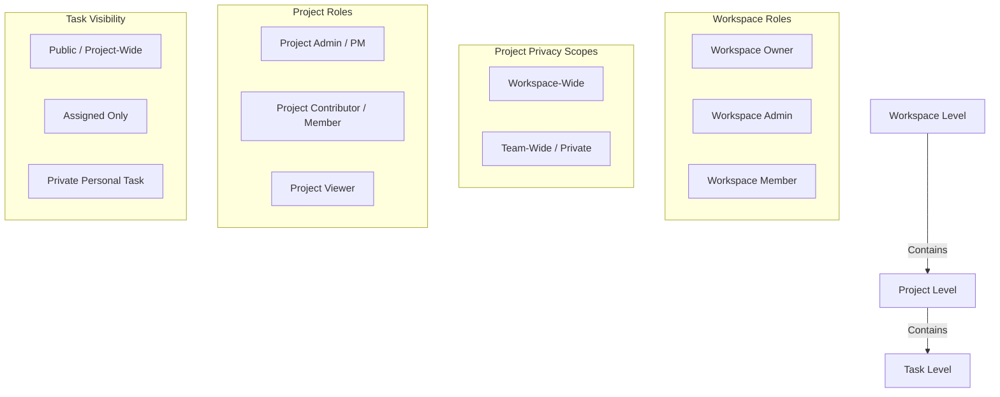

# Synca — Roles, Permissions & Access Control Architecture

> **Authoritative Specification Document**  
> Version: `1.0.0`  
> Scope: Workspace Hierarchy, Project Privacy Scopes, Project Roles, and Task-Level Visibility.

---

## 1. System Permission Hierarchy Overview

Synca uses a **three-tier inheritance model** for security and visibility:



---

## 2. Workspace-Level Roles & Authority

Every user in a Synca Workspace holds one of three workspace roles:

| Workspace Role | Description | Core Responsibilities |
|---|---|---|
| **Owner** | Workspace Creator & Super-Administrator | • Full control over workspace lifecycle (delete workspace, transfer ownership)<br>• Manage workspace subscription & integrations<br>• Access and manage **all** projects and tasks regardless of privacy settings<br>• Promote/demote members to Admin |
| **Admin** | Workspace Manager | • Invite and remove workspace members<br>• Create, edit, and archive projects<br>• Unrestricted view and override access across **all** projects (even private ones)<br>• Manage workspace settings and default templates |
| **Member** | Standard Team Member | • View workspace directory and join workspace-wide projects<br>• Create new projects (becomes Project Admin for created projects)<br>• Participate in assigned projects and tasks<br>• Cannot modify workspace settings or remove members |

---

## 3. Project Privacy & Visibility Models

When a project is created, its **Privacy Scope** dictates who in the workspace can discover and access it:

```mermaid
flowchart TD
    Req[Workspace Member Requests Project] --> PrivCheck{Project Privacy?}
    
    PrivCheck -->|Team-Wide / Private| IsInTeam{Is Member in Project Team or WS Admin?}
    IsInTeam -->|Yes| FullTeamAccess[Full Team Access to Board, List, Tasks]
    IsInTeam -->|No| Block403[403 Forbidden / Project Hidden]
    
    PrivCheck -->|Workspace-Wide| IsTeamOrAdmin{Is Member in Team or WS Admin?}
    IsTeamOrAdmin -->|Yes| FullTeamAccess
    IsTeamOrAdmin -->|No| OverviewOnly[Read-Only Overview Tab ONLY\n(Brief, Goals, Milestones)\nBoard, List, & Tasks are Hidden]
```

### A. Team-Wide (Private Project)
- **Visibility**: Strictly confidential.
- **Who can see it**: **Only** assigned project team members, the project creator, and Workspace Admins/Owners.
- **Non-Team Members**: The project does not appear in project lists, search results, or the sidebar. Direct URL navigation returns `403 Forbidden`.

### B. Workspace-Wide (Public Project)
- **Visibility**: Visible in the workspace directory and sidebar for all workspace members.
- **For Non-Team Members (Workspace Members NOT in project team)**:
  - **Allowed**: Access to the **Overview & Goals** tab in **Read-Only** mode. They can read the project brief, executive summary, high-level goals checklist, and milestone timeline.
  - **Restricted**: Cannot access the **Board (Kanban)** tab, **List View** tab, task details, or project settings. They cannot create, edit, move, or delete tasks.
- **For Project Team Members & Workspace Admins**: Full operational access (Board, List, Tasks, creating work items).

---

## 4. Project-Level Roles & Permissions

Within any given project, members of the project team hold granular project roles:

| Project Role | Description | Capabilities |
|---|---|---|
| **Project Admin / PM** | Project Manager or Creator | • Update project name, description, status, and privacy<br>• **Add, edit, or remove project team members**<br>• Assign project roles to team members<br>• Create, update, or reorder goals and milestones<br>• Create, edit, assign, and delete any task<br>• Archive or delete the project (if permitted by workspace) |
| **Project Contributor** | Active Team Member | • View all project tabs (Overview, Board, List)<br>• Create new project tasks<br>• Edit assigned tasks and subtasks<br>• Move tasks between Kanban columns<br>• Check off completed goals assigned to them<br>• Cannot change project settings, privacy, or remove teammates |
| **Project Viewer** | Observer / Stakeholder | • View project overview, goals, milestones, board, and list<br>• Read task descriptions, comments, and attachments<br>• **Cannot** create, edit, drag-and-drop, or delete any task or goal |

---

## 5. Task-Level Visibility & Access Controls

Tasks created inside a project support customizable visibility:

| Task Visibility | Accessible By | Use Case |
|---|---|---|
| **Public / Project-Wide** (Default) | All project team members + Workspace Admins | Standard collaborative tasks that anyone on the project can view, take ownership of, or discuss. |
| **Assigned Only** | Assigned users + Project PM + Workspace Admins | Sensitive tasks, code reviews, performance evaluations, or confidential deliverables restricted strictly to assignees. |
| **Personal / Private Task** | Author only (no project binding) | Personal daily reminders and notes on the Dashboard/Todo list. |

### Task Action Permissions

| Task Action | Project PM | Task Assignee | Project Contributor | Non-Team Member |
|---|---|---|---|---|
| View Public Task | ✅ | ✅ | ✅ | ❌ |
| View "Assigned Only" Task | ✅ | ✅ | ❌ | ❌ |
| Create Task | ✅ | ✅ | ✅ | ❌ |
| Edit Task Title/Description | ✅ | ✅ | ❌ (Unless assigned) | ❌ |
| Change Status / Move Column | ✅ | ✅ | ✅ | ❌ |
| Check off Subtask | ✅ | ✅ | ✅ | ❌ |
| Delete Task | ✅ | ❌ (Unless author) | ❌ | ❌ |

---

## 6. Comprehensive Authorization Matrix

The table below summarizes system capabilities across roles:

| Capability | Workspace Owner | Workspace Admin | Project PM | Project Contributor | Non-Team Workspace Member |
|---|---|---|---|---|---|
| **Delete Workspace** | ✅ | ❌ | ❌ | ❌ | ❌ |
| **Manage Workspace Members** | ✅ | ✅ | ❌ | ❌ | ❌ |
| **Create Projects** | ✅ | ✅ | ✅ | ✅ | ✅ |
| **View Workspace-Wide Project Overview** | ✅ | ✅ | ✅ | ✅ | ✅ (Read-Only) |
| **View Workspace-Wide Board & Tasks** | ✅ | ✅ | ✅ | ✅ | ❌ |
| **View Team-Wide (Private) Project** | ✅ | ✅ | ✅ | ✅ | ❌ (Hidden) |
| **Edit Project Settings (Name, Privacy)** | ✅ | ✅ | ✅ | ❌ | ❌ |
| **Add / Remove Project Team Members** | ✅ | ✅ | ✅ | ❌ | ❌ |
| **Archive / Delete Project** | ✅ | ✅ | ❌ (Requires Admin) | ❌ | ❌ |
| **Create Project Tasks** | ✅ | ✅ | ✅ | ✅ | ❌ |
| **Move / Reorder Tasks (Kanban)** | ✅ | ✅ | ✅ | ✅ | ❌ |
| **View "Assigned Only" Tasks** | ✅ | ✅ | ✅ | If assigned | ❌ |

---

## 7. Implementation Roadmap & Enforcement Points

### Backend Enforcement Points (`apps/api`)
1. **`GET /api/v1/projects`**:
   - Filter out `Private` projects if caller is not in `teamMembers` and not workspace admin/owner.
2. **`GET /api/v1/projects/:id`**:
   - `Private` project: return `403` if caller not in team/admin.
   - `WorkspaceWide` project: return project payload with flag `isTeamMember: boolean`.
3. **`GET /api/v1/tasks?projectId=`**:
   - If caller is not in project team and not admin: return empty list or `403` (preventing task leakage from workspace-wide projects to non-team members).
   - Filter out `Assigned Only` tasks for team members who are not assigned to them (unless PM/Admin).
4. **`PATCH /api/v1/projects/:id`**:
   - Verify caller is Workspace Admin/Owner or Project PM before modifying `teamMembers`, `name`, `privacy`, or `status`.

### Frontend Enforcement Points (`apps/web`)
1. **Project Detail Tabs (`/projects/[id]`)**:
   - If user is non-team on a `WorkspaceWide` project:
     - Automatically lock tab to **Overview & Goals** with an informative banner: *"You are viewing this workspace project in Read-Only mode. Join or request team access to view the Kanban board and tasks."*
     - Hide or disable **Board**, **List**, and **Settings** tabs.
2. **Project Team Management (`/projects/[id]`)**:
   - Accessible via **Settings** tab and quick **"Manage Team"** button on Overview tab.
   - Allows Project PMs and Workspace Admins to add and remove workspace members with instant profile syncing.
3. **Task Creation Modal (`<TaskModal />`)**:
   - Add visibility toggle: **Project-Wide (Public)** vs **Assigned Only (Restricted)**.
